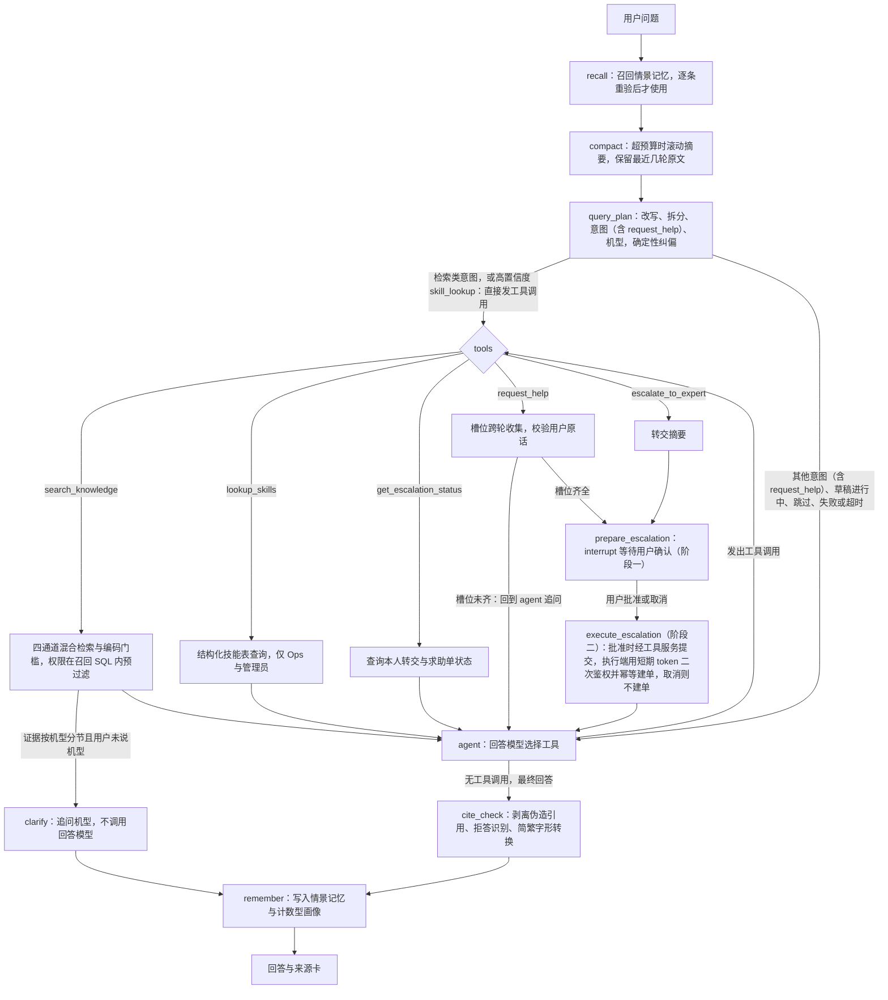

# Knoventra · 知域

## 1. 项目简介

权限感知的企业知识问答与现场求助助手：员工只能检索自己有权读的资料，回答带有可核验到文档版本和页码的引用；找不到可靠依据时拒答；现场问题可在确认后转为求助单、派给合适的专家，解决后的经验以脱敏案例回流知识库。

技术栈：Python 3.12 / FastAPI / LangGraph / PostgreSQL + pgvector / Elasticsearch 8.15 / Redis / MCP（streamable HTTP）/ React（Vite + TypeScript）。

参考 [Ragent](https://github.com/nageoffer/ragent) 的工程设计，后端与前端均为独立重写（来源见第 7 节）。**演示使用的企业、人员、设备、日志和资料全部虚构**，不含任何真实企业的代码、文档、账号、配置或客户信息。

## 2. 架构与请求链路

一次问答在 LangGraph 图里依次经过下列阶段。图的节点名（`start_turn`、`recall`、`compact`、`query_plan`、`agent`、`tools`、`prepare_escalation`、`execute_escalation`、`clarify`、`cite_check`、`remember`）与 `backend/src/knoventra/agent/graph.py` 一致。



- 身份与权限只来自服务端：工具参数里没有身份字段；工具在进程内或独立 MCP 服务中执行时，都由每次运行签发的短期 token 重新计算权限。
- PostgreSQL 是唯一事实源。Elasticsearch（关键词通道）和 Redis（工作记忆）都是可丢弃的副本：不可用时降级或从 PG / Checkpoint 重建，不放宽权限。
- 图状态由 PG Checkpoint 持久化，聊天与确认共用会话级互斥锁；失败或未保存的请求可用 `/chat/retry`、`/chat/recover` 恢复。

## 3. 核心能力

以下按系统模块列出架构边界与不变量。各项的取舍与理由见 [DECISIONS](docs/DECISIONS.md)，实现细节见[后端说明](backend/README.md)。

### 权限内生与知识入库

- **权限**：区域 / 部门 / 角色授权在召回 SQL 内预过滤；权限为空或查询失败时不检索（fail-closed）。
- **文档版本**：新修订先是草稿，发布在串行化事务内完成；数据库约束保证每个文档至多一个生效修订；空文档或编码结果缺失时拒绝入库，发布失败时旧版继续生效。
- **现场日志与技能矩阵**：模板按表头定位列，日志行和技能行可混排在同一张表；入库前先脱敏（口令、电话、邮箱），再做精确去重和同机型内的 SimHash + Jaccard 近似去重；去重后的案例发布到 `field-cases` 知识库，每个案例一个分块。

### 四通道混合检索与精确编码门槛

- **四个召回通道**：BGE-M3 稠密向量、BGE-M3 稀疏向量（OpenCC 简繁归一，仅用于稀疏侧）、分块 `identifiers` 列的 GIN 精确召回、Elasticsearch（IK 分词、拼写纠错表、中英同义词）。
- **ES 同步与降级**：事务性 outbox 同步，`drain / reconcile / rebuild` 命令对账；ES 的每个命中都回 PG 复查发布状态和读权限；ES 不可用时降级为 PG 通道。
- **融合**：加权 RRF，按查询是否含编号使用两套权重，`rrf_weighting=equal` 为对照。
- **精确编码门槛**：问题中显式的故障码 / SOP 编号必须出现在已授权候选的正文或章节路径中，且最终证据要覆盖全部必需编号；机型名不是必需编号，单独按机型过滤。

### 查询理解、澄清与可核验引用

- **`query_plan`**：用函数调用产出改写、最多 3 个子查询、意图、置信度和机型，再由确定性代码纠偏（修拼写、补回被改写丢掉的编号、丢弃对话里没提到的机型）。路由只能把检索范围收窄到“可读 KB ∩ 意图 KB”，交集为空或置信度低于 0.6 时检索全部可读 KB；规划失败或超时（8 秒）回退到不规划的路径。
- **机型澄清**：证据来自按机型分节的文档而用户没说机型时，在“检索后、作答前”追问，不调用回答模型。
- **引用**：证据注册表记录每次检索的来源；`cite_check` 剥离伪造的引用标记，识别简体 / 繁体拒答声明并清空来源卡，按当前问题的字形转换回答正文；来源预览每次重新鉴权。

### 求助单闭环与经验沉淀

- **槽位收集**：跨轮收集机台、症状、已尝试步骤等，服务端强制核对用户原话，防止模型把检索到的资料抄进槽位；说“算了”会清空草稿。
- **专家推荐**：只推荐技能为“掌握”的工程师，按同区域、未结单少、作业次数多排序，理由显示在确认卡上；没有合适人选则进入待派单队列。
- **状态机与流水**：状态迁移由服务端按动作和角色校验，事件流水由数据库触发器保证只追加；前端有“我的求助单”和“专家工作台”。
- **结案沉淀**：求助单解决时，在同一事务内生成脱敏的案例草稿；管理员预览并发布后才进入检索。

### 分层记忆与复用前重验

- **Checkpoint**：PG Checkpoint 持久化图状态，是槽位草稿的持久记录。
- **短期工作记忆**：Redis（`knv:wm:{user_id}:{thread_id}`，TTL 24 小时）保存槽位草稿和滚动摘要；副本带锚点，与 Checkpoint 不符、丢失或 Redis 不可用时重建。历史超过 Token 预算（默认 6000，近似计数）时保留最近 3 轮，更早的轮次压缩成摘要；摘要不读取工具输出和证据，Checkpoint 保留全文。
- **长期情景记忆**：pgvector 保存按用户隔离的情景；每轮最多召回 3 条，使用前逐条重验（引用资料仍已发布且当前可读、求助单仍属本人且已解决），失效整条丢弃。
- **画像与上下文**：用户画像只做计数（字形、机型、提交过求助的机台），不参与权限；上下文组装器按优先级填预算，本轮工具结果不截断。本人可经 `GET /memory`、`DELETE /memory` 查看和删除。

### 独立 MCP 工具服务与会话可靠性

- **MCP**：检索、技能查询、求助单查询、准备和提交求助单共 5 个工具，可在 API 进程内执行，也可由独立的 streamable HTTP MCP 服务执行（设置 `KNV_MCP_URL`）。每次运行签发短期、受众隔离的 JWT，不进入 Checkpoint；写操作按 `confirmation_id` 在执行端二次鉴权并幂等提交。
- **会话**：PG 会话级互斥锁（409 `CONVERSATION_BUSY`）；失败检查点可续跑（`/chat/retry`）；回答已完成但未保存时可无模型补存（`/chat/recover`）。

## 4. 评测与验证概览

下表中的数字均来自 [评测报告](docs/evaluation-report.md)，只适用于对应的虚构语料和用例，不代表真实部署效果；各 Agent 层结果均为单模型（`deepseek-flash`）单次运行，未估计波动。

| 验证类别 | 规模 | 核心结果 | 报告章节 |
|---|---|---|---|
| 确定性自动化测试与验收 | 后端 937、前端 157；HTTP 验收（含 `--mcp`）与容器验收 | 在 PG、ES、Redis 可达时全部通过；不调用付费模型 | 第 26.1 节、[CI 说明](docs/ci.md) |
| v3 检索消融 | 评测集 60 例 + 四组各 28 例的验证 / 回归集 | 小语料下 Recall@5 饱和；精排默认关闭 | 第 1–25 节中 v3 部分（含第 13、18、21 节） |
| v4 现场检索 | 39 例（dev 24 / 留出 15） | Recall@5 三种配置均为 1.0；越权泄露 0；加权与等权在该集上分不出差别 | 第 25 节 |
| v4 查询改写 / 规划消融（检索层） | 39 例，规划器只调一次并缓存；`pg` / `es_weighted` × 三种查询模式 | 改写本身无可见净收益；机型过滤小幅改善来源名次；路由有 1 次误判，使 dev 的 `full_plan` 召回 1.000 → 0.955；越权泄露 0 | 第 27 节 |
| v4 Agent 层真实模型 | 42 例（dev 24 / 冻结留出 18） | dev 首轮 22/24，修复后 24/24；冻结留出集只跑一次，**16/18** | 第 26 节 |

## 5. 已知局限、未测量项与范围边界

### 已知缺陷与模型局限

- 意图路由判错会把目标排除在检索范围之外：改写消融的 dev 里，“远程支持时怎么登录客户 VPN”被判为 `it_guide`，漏掉了 `field-cases` 中的目标案例（路由只能缩小范围，不会越权）。该消融样本很小，规划器单模型单次，见第 27 节。
- 留出集暴露：只说“提个求助单”而没有任何细节时，规划器没有“发起求助”意图，该轮被当作普通问答检索，回答模型也只用文字追问，因此漏建求助单（`a6-07`）。封版后已在代码中修复该机制缺陷（新增 `request_help` 意图和确定性兜底，见 [DECISIONS](docs/DECISIONS.md) 第 80 条）并有离线回归测试覆盖；但冻结留出集只允许运行一次，**没有重跑，`16/18` 仍是封版时的实测值**，修复后的真实模型效果未测量。
- 回答类情景记忆原先只记录本轮最后一句提问，短追问（如只回机型）缺少上文。封版后已改为：首问保持原话，多轮时用规划器改写，或在机型澄清 / 极短追问时拼接上一问（第 80 条）；这是确定性启发式，只有离线回归测试，未测量记忆召回质量。
- 精排（Rerank）在小语料上没有稳定的净收益，阈值也没有独立标定，默认关闭。
- 离线容器演示使用 Hash 编码器，纯编号或极短问句的余弦分数偏低，因此演示脚本使用带主题词或机台号的问法。
- 端到端只用了单个模型（`deepseek-flash`），每份报告都是单次运行，没有估计波动。

### 尚未完成的测量与审核

- 滚动摘要质量与压缩后的槽位保留率：未测量。
- 情景记忆召回质量与 `0.5` 相似度阈值的标定：未测量。
- 真人逐句回答支持度审核数仍为 `0`；模型审核不能替代人工审核。
- v4 的七个演示故事尚未录制新版视频。

### 明确不做（Out of Scope）

- LLM 案例字段抽取（按可砍清单，仅保留规则抽取）。
- OCR。
- 异步入库队列。
- 真实企业 SSO 与 IM 通知推送。
- 多租户，以及跨区物理分集群的数据驻留。

## 6. 快速开始

### 方式 A：Docker Compose 六服务离线演示

只需 Docker 与 Compose v2，不需要本机 Python / Node。在仓库根目录运行：

```bash
docker compose -f deploy/compose.demo.yaml up --build -d --wait
```

打开 [http://127.0.0.1:8088](http://127.0.0.1:8088)。栈内包含 PostgreSQL、Elasticsearch、Redis、MCP 工具服务、API 和 Web 六个服务；使用独立数据库和脚本化的固定回答，回答标注“演示用固定回答”，不加载 BGE、不调用真实模型，只验证权限、引用、版本、求助单与记忆等流程。首次构建需要访问镜像仓库、PyPI 和 npm。

重置为初始演示数据（会删除这套演示的数据卷）：

```bash
docker compose -f deploy/compose.demo.yaml down --volumes
```

端口占用、数据持久化与自动验收见[容器演示说明](docs/container-demo.md)。

### 方式 B：本地开发与真实模型运行

需要 Docker、[uv](https://docs.astral.sh/uv/)、Node 20+。真实检索需要 GPU 或较强 CPU 加载 BGE-M3（约 2.2GB，首次运行从 HuggingFace 下载）。

1. 启动 PostgreSQL、Elasticsearch、Redis（首次会构建带 IK 插件的 ES 镜像，需联网）：

   ```bash
   docker compose -f deploy/compose.yaml up -d --wait
   ```

2. 安装依赖、迁移并导入默认种子（种子含虚构资料、PDF 和现场作业 SOP）：

   ```bash
   cd backend
   uv sync --extra ml
   uv run alembic upgrade head
   KNV_ENCODER=bge-m3 uv run python -m knoventra.db.seed
   ```

3. 导入虚构的现场日志与技能矩阵，并把去重后的案例发布到 `field-cases`：

   ```bash
   uv run python -m knoventra.ingestion.journal ../data/demo/journals/*.xlsx --registry ../data/demo/journals/machines.json --publish-kb field-cases
   ```

4. 配置并启动后端：复制 `.env.example` 为 `.env`，填入 OpenAI 兼容的 `KNV_LLM_BASE_URL`、`KNV_LLM_API_KEY`、`KNV_LLM_MODEL`。使用 DeepSeek 的工具调用时必须设置 `KNV_LLM_THINKING=disabled`：其默认思考模式要求回传推理历史，当前通用适配器不保留该字段；其他服务保持 `provider-default`。详见[后端说明](backend/README.md#llm-与-thinking-模式)。

   ```bash
   cp .env.example .env
   uv run uvicorn knoventra.main:app
   ```

5. 启动前端（默认把 `/api` 代理到 `http://localhost:8000`，可用 `KNV_API` 覆盖）：

   ```bash
   cd ../web
   npm install
   npm run dev
   ```

演示账号与资料见 `data/demo/manifest.json`（密码为虚构的演示值）。不想配置模型时，可运行 `backend/dev/mock_server.py` 检查界面，其回答是固定的，不代表问答质量。

**可选：启用 ES / Redis / MCP**（均不设置时只用 PG 的三个召回通道、每次从 Checkpoint 重建草稿、工具在 API 进程内执行）：

- ES：`.env` 设置 `KNV_ES_URL=http://localhost:59200`，然后在 `backend/` 执行 `uv run python -m knoventra.search_es.sync rebuild` 建立索引；之后发布会自动同步，`reconcile` 用于对账补齐，`drain` 用于消费 outbox。
- Redis：`.env` 设置 `KNV_REDIS_URL=redis://localhost:56379/0`。
- MCP：在 `backend/` 执行 `uv run python -m knoventra.mcp_server`（默认 `127.0.0.1:58765`），`.env` 设置 `KNV_MCP_URL=http://127.0.0.1:58765/mcp`，并给 `KNV_TOOL_TOKEN_SECRET` 设置一个与 `KNV_JWT_SECRET` 不同的值（API 与 MCP 服务读取同一个 `.env`）。

**测试与验收**（均在 `backend/` 下；测试使用独立的 `knoventra_test` 库和离线 Hash 编码器，不需要模型；ES / Redis 测试在不可达时跳过，设置 `KNV_REQUIRE_ES=1`、`KNV_REQUIRE_REDIS=1` 后改为失败，CI 即如此运行）：

```bash
uv run pytest
uv run --no-sync python dev/check_migrations.py
uv run --no-sync python dev/check_demo.py
uv run --no-sync python dev/check_demo.py --mcp
```

`dev/check_compose_demo.py` 对容器演示做同等验收，前端用 `cd web && npm test && npm run build && npm run lint`。范围见[自动化验收](docs/ci.md)。

**三套评测入口**（在 `backend/` 下；详细参数见[后端说明](backend/README.md#评测工具链)）：

```bash
# 检索层：不调用 LLM
KNV_ENCODER=bge-m3 uv run python eval/run_eval.py --split dev

# v4 现场检索：先建独立评测库，再比较三种配置，不调用 LLM
KNV_ENCODER=bge-m3 uv run python eval/setup_field_eval.py
KNV_ENCODER=bge-m3 uv run python eval/run_field_eval.py --split dev

# Agent 层：先离线预检；真实运行会产生模型费用，需要 --allow-llm 并事先确认预算
uv run python eval/run_agent_eval.py --split dev --dry-run
```

留出集只能用 `--confirm-final` 运行一次，不得针对它调参或重跑。

## 7. 文档导航与上游来源

**架构与计划**

- [开发方案 v3.0](docs/knoventra-development-plan.md)
- [v4 计划](docs/knoventra-v4-plan.md)
- [关键架构决策](docs/DECISIONS.md)

**评测与审核**

- [评测报告](docs/evaluation-report.md)
- [回答支持度审核流程](backend/eval/REVIEW.md)（含真人审核页的生成与使用说明；审核页 HTML 需在本地浏览器打开，GitHub 网页端只会显示其源码）

**演示与 CI**

- [v4 演示脚本](docs/demo-v4-script.md)
- [演示与会话恢复验证（v3 手册）](docs/demo-guide.md)
- [容器化离线演示](docs/container-demo.md)
- [本地浏览器流程录像（脚本模型）](docs/demo/README.md)
- [自动化验收与 CI](docs/ci.md)

**子模块说明**

- [后端说明](backend/README.md)
- [前端说明](web/README.md)

**上游基线与来源**

- 源项目：[nageoffer/ragent](https://github.com/nageoffer/ragent)，基线提交 [`c3b6157`](https://github.com/nageoffer/ragent/commit/c3b6157730ac1f66a312bcd286c47d3ee6aaac42)，许可证 [Apache-2.0](LICENSE)。
- 上游的 Java 源码、`frontend/`、数据库脚本、原项目介绍及其 `docs/` 文档与架构图曾作为设计参考保留在仓库中，2026-11-24 已从当前目录树移除，仍可在提交历史中查到（基线导入提交之后、移除提交之前的任一版本）。**Python 后端（`backend/`）与前端（`web/`）为独立编写，未复制上游代码。**
- 详细来源说明见 [THIRD_PARTY_NOTICES.md](THIRD_PARTY_NOTICES.md)。
