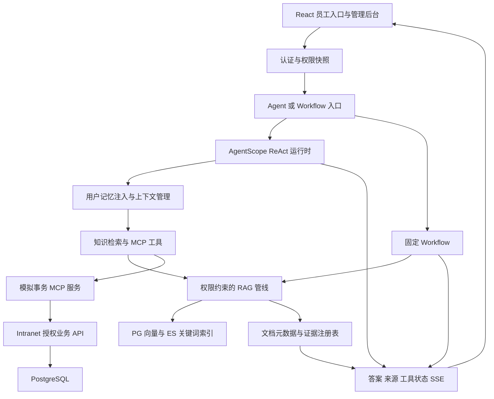

# Knoventra · 知域：企业内网知识助手二次开发方案

版本：设计稿 v1.0 · 日期：2026-10-26 · 状态：待实施

目标仓库：https://github.com/BeforeLanding/Knoventra

上游基线：[nageoffer/ragent@c3b6157730ac1f66a312bcd286c47d3ee6aaac42](https://github.com/nageoffer/ragent/commit/c3b6157730ac1f66a312bcd286c47d3ee6aaac42)，提交日期 2026-10-25。

本文面向后续实际开发。标记“现有”的内容来自该基线源码静态核对；标记“新增”“计划”“目标”的内容尚未实现。没有进行全项目编译、真实模型测试或部署验证，不把上游宣传指标作为本项目成绩。

阅读导航：

- 产品与基线：[项目定位](#1-项目定位与交付边界)、[源码依据](#2-上游现状与改造依据)、[业务故事](#3-业务角色与演示故事)。
- 核心技术：[架构与流程](#4-目标架构与业务流程)、[权限](#5-权限模型先限定数据再进行推理)、[RAG](#6-rag知识入库检索与证据链)、[记忆](#7-分层记忆与上下文治理)、[MCP](#8-mcp-模拟工具与业务一致性)。
- 工程实现：[数据模型](#9-数据模型与数据库迁移)、[API](#10-api-设计与错误语义)、[前端](#11-前端信息架构与体验)、[演示数据](#12-演示数据与公开边界)、[部署](#13-环境部署与可观测性)。
- 交付管理：[测试与评测](#14-测试评测与验收标准)、[阶段计划](#15-分阶段实施计划)、[首批任务](#16-首批可执行开发任务)、[风险取舍](#17-风险取舍与退出条件)、[许可与完成定义](#18-仓库管理许可与完成定义)。

## 1. 项目定位与交付边界

Knoventra 将企业内网中的制度、部门资料、公告和操作指引整合为一个带引用的知识助手。员工可以查询“需要什么材料”“应该走哪个流程”，也可以在同一对话中查询模拟申请状态，并在确认后提交演示事务。

业务需求抽象自常见的内联网门户：部门频道、内容发布、员工身份与权限、多语言、知识问答。个人项目独立实现这些通用需求，不复制任何企业源码、文档、品牌、账号或基础设施配置。

### 1.1 首版范围

- 单个虚构企业、多个部门频道、多个知识库，不承诺完整 SaaS 多租户能力。
- 五类内容：员工制度、财务指引、IT 手册、安全规范、公共公告。
- 员工问答与跨库检索、管理员知识入库、知识更新和原文溯源。
- 知识库级权限，库内文档继承权限；首版不支持同一库内复杂的逐文档授权。
- Workflow / Agent 两种引擎继续保留，首版主界面使用 Agent 档。
- 中英文提问和回答，知识来源原文不被回答语言覆盖。
- 模拟公告查询、申请进度查询，以及需确认的模拟 IT 工单创建。
- 用户级长期记忆管理和可重复的评测数据集。

### 1.2 后续扩展

马来语与泰米尔语、图谱增强检索、内容阅读回执、多模态资料、细粒度文档授权、外部身份提供商和真实企业连接器，均作为首版后的独立任务。

不在首版重建完整新闻门户、视频转码、短信验证码平台、人事主数据或真实审批引擎。个人演示使用本地账号，不发送真实短信，不提交真实申请。

### 1.3 项目自己的技术贡献

优先形成四个可验证增量：

1. 权限感知的全链路知识访问，覆盖召回、引用、下载、缓存和历史上下文。
2. 有版本与生效时间的知识更新，解决旧制度仍被检索的问题。
3. 知识与模拟事务工具协同，展示 ReAct 的多步决策和确认恢复。
4. 面向内网场景的中英文评测与记忆管理，给出可复现的实测报告。

## 2. 上游现状与改造依据

### 2.1 已核对的技术基线

- 根 `pom.xml`：Java 17、Spring Boot 4.1.0、AgentScope 2.0.2；不沿用旧文档中的 Spring Boot 3.x 版本描述。
- `frontend/package.json`：React 18、TypeScript、Vite 5、Zustand；保留现有前端技术栈。
- `bootstrap/src/main/resources/application.yaml`：服务端口 9090，当前 context path 为 `/api/ragent`，默认 `ragent.engine.type=agent`。
- 默认数据库 PostgreSQL，默认向量存储为 PG；Redis、S3 兼容对象存储与 RocketMQ 继续按实际业务装配。
- 源码包含向量、ES 关键词、LightRAG 图谱及联网搜索通道，但默认只有向量通道开启。不能把“支持通道”写成“已启用混合检索”。
- Workflow 的模型调度能力与 Agent 主模型链路分开：当前 Agent 主模型配置明确为单模型，不假设它自动继承 Workflow 的模型切换能力。

### 2.2 现有模块的去向

- `framework`：继续承载用户上下文、异常、SSE、任务取消与通用设施，不加入内网具体业务。
- `infra-ai`：保留模型供应商适配、Embedding / Rerank 等能力，不在首版替换模型抽象。
- `system`：扩展部门、频道、成员关系、资源授权与权限版本；向上层提供窄接口。
- `rag`：扩展权限约束、文档元数据、知识版本和结构化证据输出。
- `agent`：保留 ReAct 引擎、确认、状态与中间件，扩展内网人设、来源事件和记忆策略。
- `bootstrap`：仅负责启动装配和环境配置。
- `mcp-server`：保留原示例，另加可选的内网模拟工具组，不默认混入电商等无关工具。
- 新增 `intranet` Maven 模块：承载公告、频道内容、模拟工单、入口 API 和知识同步编排。

目标依赖方向：`intranet -> rag -> system -> framework`，`agent -> rag`，`bootstrap -> agent + rag + intranet`。业务权限接口放在 `system`，防止 `rag` 与 `intranet` 互相依赖；新模块注册与组件扫描属于待实现改动。

### 2.3 关键源码落点

以下路径均相对于仓库根目录，作为后续任务定位依据：

- Agent 装配：`agent/src/main/java/com/nageoffer/ai/ragent/agent/config/ReActAgentProvider.java`。
- Agent 发起、确认与收尾：`agent/src/main/java/com/nageoffer/ai/ragent/agent/service/impl/AgentChatServiceImpl.java`。
- 知识工具：`agent/src/main/java/com/nageoffer/ai/ragent/agent/tool/KnowledgeSearchTool.java`。
- 知识门面：`rag/src/main/java/com/nageoffer/ai/ragent/rag/service/KnowledgeSearchFacade.java`。
- Workflow：`rag/src/main/java/com/nageoffer/ai/ragent/rag/service/pipeline/StreamChatPipeline.java`。
- 检索引擎：`rag/src/main/java/com/nageoffer/ai/ragent/rag/core/retrieval/MultiChannelRetrievalEngine.java`。
- 检索作用域：`rag/src/main/java/com/nageoffer/ai/ragent/rag/core/retrieval/channel/RetrievalScopeResolver.java`。
- 检索后处理：`rag/src/main/java/com/nageoffer/ai/ragent/rag/core/retrieval/postprocessor/`。
- Agent 记忆：`agent/src/main/java/com/nageoffer/ai/ragent/agent/memory/`。
- 当前用户角色：`system/src/main/java/com/nageoffer/ai/ragent/user/enums/UserRole.java`。
- 数据库：`resources/database/schema_pg.sql`、`resources/database/init_data_pg.sql`。
- 前端路由：`frontend/src/router.tsx`；知识、会话与 Agent 服务在 `frontend/src/services/`。

当前源码的核心运行时由 `ReActAgentProvider` 与 `AgentChatServiceImpl` 等共同构成；本文中的 Agent Runtime 是职责概念，不声称仓库已有一个名为 `AgentRuntime.java` 的类。

## 3. 业务角色与演示故事

### 3.1 角色与数据范围

- 员工：查看公共频道及加入的部门频道，查询自身申请和个人会话。
- 频道维护者：管理被授予维护权限的频道内容与关联知识库，不能自动读取其他部门资料。
- 平台管理员：配置系统、账号和授权；跨部门资料读取仍需显式审计的管理权限。

上游当前只有 `admin` / `user` 两类全局角色。首版保留它们作为平台角色，把频道维护权限放入成员关系，避免把每个部门都增加成全局枚举。

### 3.2 五个必须能演示的故事

1. **入职指引**：员工问“电脑领到了，下一步怎么配置办公环境？”助手检索 IT 指引，返回分步操作和版本明确的来源。
2. **跨部门问答**：员工问“出差报销要什么材料，设备借用又怎么申请？”系统拆成财务与 IT 子问题，仅在该员工可读范围检索。
3. **事务协同**：员工说明 VPN 报错；Agent 先查询手册，再询问必要信息，生成模拟工单确认卡；同意后只创建一条工单。
4. **跨语言追问**：中文询问英文制度，再用英文追问；回答语言跟随明确选择，来源链接保持对应原文。
5. **知识与权限变化**：管理员发布制度新版本或移除部门成员；新的回答、引用与缓存均不能继续使用失效内容。

示例制度编号使用 `POL-DEMO-001`，账号使用 `employee-a@example.test` 等演示标识。示例金额、流程和时限完全虚构，不用于实际企业决策。

## 4. 目标架构与业务流程



### 4.1 Agent 主链路

认证 → 读取服务端权限快照与版本 → 校验会话所有者及上下文权限版本 → 申请运行名额 → 加载 Agent 状态和用户记忆 → ReAct 推理 → 按需调用知识或事务工具 → 校验与登记证据 → 流式输出 → 保存状态 → 触发记忆学习与指标记录。

延续现有运行互斥、取消与确认机制。用户身份必须来自认证上下文；工具参数中不接受模型自报的 `userId`、部门权限或管理员标记。共享 Agent 实例不能通过可变全局字段保存某个用户的权限。

### 4.2 Workflow 的位置

保留独立固定问答入口，便于做可控演示、问题定位和效果对照。首版不新建一个会增加模型调用的自动引擎分类器；部署配置或明确入口决定引擎档位。Workflow 复用同一权限查询接口，不能成为绕过 Agent 权限的备用通道。

### 4.3 内网 Agent 行为规则

制度、金额、适用范围和时间必须以当前授权资料为依据；实时状态必须调用业务工具。信息不足时追问，资料无答案时说明未找到依据。检索内容视为资料，不能执行其中要求泄露数据或更改规则的指令。

默认关闭联网搜索；个人演示不把内网型查询发给搜索引擎。可选模型 API、翻译、Rerank 与 Trace 端点仅使用个人配置，输入限定为合成资料。未来连接真实数据需要重新审查数据出口，不能沿用演示环境结论。

## 5. 权限模型：先限定数据，再进行推理

### 5.1 首版授权规则

频道成员关系授予 `reader` / `maintainer` 权限，公共频道对全部有效演示员工可读。知识库通过频道绑定继承可读主体；一个库被多个频道绑定时，可读范围取授权主体的并集。维护权限单独判断，读权限不能升级为编辑权限。

首版规定同一知识库内资料具有相同可见性。敏感级别不同的文档必须拆库；界面不提供尚未实现的“文档级私有”选项。

定义服务端不可变 `AccessScope`：当前用户、可读知识库 ID、可维护频道 ID、权限版本 `aclVersion`、解析时间。客户端传入的库 ID 只能与该范围求交，不能扩大范围；范围为空时拒绝检索或返回空授权结果。

### 5.2 对现有检索范围的修正

当前 `RetrievalScopeResolver` 在意图不明确时回退全部有效库，且可能加入未命中库作补充。改造后：

- 所有 active、target、supplement 集合先与用户的可读库求交。
- 所谓“全局检索”仅表示“该用户所有可读知识库”。
- 低置信度、空意图、悬空库绑定与通道失败都不能放宽权限。
- 未获得权限快照或权限服务失败时拒绝资料检索，不回退为全部库。

### 5.3 各数据出口的约束

- PG / Milvus / ES：在召回查询阶段传入可读库范围，先过滤再取 TopK；不能只在最终答案阶段删除越权内容。
- Rerank 与模型：只接收授权候选；外部模型前再次校验当前发布版本和权限。
- 图谱：只有能够可靠传播知识库来源和访问范围时才能启用；不能证明隔离时保持关闭。
- 引用与预览：通过有鉴权的后端读取接口提供，逐次校验文档权限与版本，不返回可长期访问的对象存储裸 URL。
- 缓存：新建问答缓存时，键必须包括用户或权限集合指纹、`aclVersion`、知识版本、语言、模型与模板版本；权限更改后缓存失效。
- 对话与摘要：记录依赖的知识库、文档版本及权限版本；权限变化后重建允许使用的历史视图并丢弃旧摘要与 Agent 缓存状态，消息列表和来源预览也重新鉴权。
- 运行中的请求：在每次工具调用、证据登记和输出阶段检查权限版本；不匹配即取消并要求重新发起。已发送到用户端的内容不能撤回，该限制必须明示。
- 管理接口、统计、导出和 Trace：遵守相同的主体范围，错误信息不透露不可见文档名称或内容。

权限变化无法使已经下载或已经发送的资料消失；首版目标是阻止后续读取、后续模型输入和后续输出继续使用已失效授权。

## 6. RAG：知识入库、检索与证据链

### 6.1 文档元数据与生命周期

复用现有获取、解析、分块和索引 Pipeline，扩展：业务文档 ID、修订版本、语言、原文语言、标题、所属频道、知识库、发布时间、生效时间、失效时间、内容哈希和索引代次。

业务发布状态单独定义为 `DRAFT -> INDEXING -> PUBLISHED -> RETIRED`，失败进入 `INDEX_FAILED`。不直接复用或改写上游解析任务状态，以免把“解析成功”误认为“已经对员工生效”。

同一文档同一语言仅有一个当前生效版本；未来生效资料不提前参与问答。中英文是同一业务文档的语言变体，翻译版本具有明确的源版本关联。

### 6.2 分块与更新

首版保留上游已有分块策略，优先保留标题、章节、制度编号与表格上下文；以评测决定参数。父子分块可作后续对照实验，不列为当前已实现能力。

每次更新先生成新修订的分块与索引，校验完成后在数据库事务中切换活动版本。PG、ES、对象存储不能假设存在跨系统事务：复用任务机制记录事件、幂等键、重试次数和每通道索引水位。

发布前要求所有已启用通道达到相同代次；查询仍须回表检查当前活动版本，避免旧索引残留进入模型。文档停用先阻断可读状态，再异步回收索引。失败保留上一已发布版本，新版本不得半发布。

### 6.3 检索主链路

用户问题与授权上下文 → 查询词映射 → 问题重写 / 拆分 → 树形意图识别 → 授权范围内路由 → 各通道并行召回 → 去重 → 加权 RRF → Rerank → 证据闸门 → 元数据富化 / 活动版本与权限复核 → 生成带引用答案。

具体策略：

- 向量使用 PG 默认实现，关键词通道首版启用 ES 后形成双路混合检索；图谱与 Milvus 留作可选配置。
- 制度编号、错误码、专有名词保留原样进入关键词查询；中英文同义词映射可维护。
- 先按原文语言优先召回，再考虑另一语言；选用支持中英文的 Embedding，并以跨语言评测验证，不宣称默认模型天然达标。
- 融合前按稳定 Chunk ID 与版本去重，避免重复文档占满候选池；保留召回通道归因。
- 初始实验沿用当前 `recall-budget=20`、`rerank-candidate-limit=40`、`default-top-k=10`，它们是调参起点，不是最佳参数结论。
- 超时通道可降级，授权服务失败不可降级成无约束检索；全部通道失败与无答案必须返回不同的内部状态。

当前 `EvidenceGatePostProcessor` 以整批最高精排分判断批次是否保留，并非逐条过滤；精排缺分时存在放行路径。Knoventra 对制度性回答计划增加“无可靠证据就返回检索失败或明确未找到”的策略，阈值按模型与语言评测校准，不把精排分称为通用置信概率。

### 6.4 Agent 档的引用补齐

当前 `KnowledgeSearchFacade.search()` 返回 RAG 合成的字符串，并移除内部文档锚点；Workflow 的来源输出不能直接假设已经完整贯穿 Agent。

计划保留原 String 入口兼容已有调用，增加内部结构化返回：`KnowledgeSearchResult` 包含状态、合成文本、Evidence 列表、检索 Trace ID。每个 Evidence 带文档 ID、修订、Chunk ID、来源语言、标题、片段和服务端生成的证据标识。

结构化证据存入本次运行的服务端证据注册表，主 Agent 只接收足够回答的文本与标识。新增来源 SSE 事件和最终引用校验：只有注册过、仍授权且版本有效的证据才能成为可点击来源；模型编造的标识不可渲染为有效引用。不得把敏感内部 ID 直接拼入自然语言回答。

客户端重连、会话回放和跨多次知识工具调用均须恢复证据映射；同一证据去重，跨语言来源保持独立。首版保留 RAG 内部答案合成，另记录这次额外模型调用的成本；“纯检索工具”作为后续独立实验。

## 7. 分层记忆与上下文治理

### 7.1 已有实现与复用策略

短期上下文由 Agent 状态与会话消息承载；`AgentContextTrimmer` 裁剪允许清理的旧工具结果，`AgentContextCompactor` 与 `AgentConversationSummarizer` 压缩较早历史；`AgentUserMemoryMiddleware` 注入用户长期记忆。

当前 Agent 按字符预算管理上下文：运行配置为 100,000 字符，裁剪线为 50%，压缩线为 80%，压缩后近期原文最低保留量为预算的 20%，摘要目标被限制在 1,500～6,000 字符。配置类未被 YAML 覆盖时的字段默认值不同，测试应明确加载哪份配置。

这些是字符阈值，不是 Token 阈值，也不是模型窗口大小。必须把人设、工具 Schema、长期记忆、历史、知识工具输出和预留回答一并纳入实际模型输入监测；必要时增加 Token 估算与模型窗口检查。

当前长期记忆从 PG 中读取该用户的有效事实条目，并通过受容量约束的记忆块注入，不是默认进行向量 TopK 召回。`AgentMemoryLearner` 配合用户游标、锁和提交检查进行增量学习，另有主动记忆写入工具。首版复用这些机制，不再设计一套平行的长期记忆向量库。

### 7.2 内网场景的记忆内容

允许记录：用户明确表达的语言偏好、回答详略偏好、持续关注的非敏感任务。拒绝记录：密码、密钥、证件号、私人联系方式、同事隐私，以及把检索资料大段复制成用户事实的内容。

部门、角色、权限来自业务数据库，不允许模型通过长期记忆决定。制度、金额、审批状态来自当次有效检索或工具，不把旧对话中的描述当作最新事实。

首版长期记忆默认关闭，员工可在个人设置主动开启；关闭后停止注入与抽取。用户可查看、删除单条及清空个人记忆。自动学习与 `MemoryFlushTool` 都必须经过同一用户开关和内容策略，不能仅靠提示词禁止写入。

### 7.3 记忆管理规则

- 用户隔离：读写条件固定包含认证用户 ID，管理员查看个人内容使用单独授权并留审计。
- 对话内追问：保护当前工具调用与结果的配对，保护未确认操作；摘要保留任务目标、已尝试步骤和用户限制。
- 摘要失败：不先删除原文；继续裁剪或返回明确错误。不能静默丢掉尚未提交的业务状态。
- 冲突处理：新事实更新或使旧条目失效，保存来源消息和表达时间；首版复用上游现有字段，若需要完整修改历史再增加审计表。
- 权限撤销：旧知识不得通过历史、摘要、工具结果或记忆重新注入；按第 5 节重新过滤和重建状态。
- 删除：删除当前有效记忆不会自动阻止后台从旧消息重新学习。清空操作必须同步处理抽取游标和删除屏障；删除引用消息、后台抽取并发写入和用户关闭开关均纳入回归测试。
- 保留期：个人演示建议会话 30 天、审计元信息 90 天；这些为待配置策略，不能宣称已有定时清理任务。业务事实的长期保留需要独立选择，不默认永久保存。

## 8. MCP 模拟工具与业务一致性

### 8.1 工具清单

新增内网工具组，默认不装载原示例中与本业务无关的工具：

- `list_announcements`：只读，查询当前用户可读频道的已发布公告，支持主题、日期和分页；返回真实字段，不由模型编造。
- `get_request_status`：只读，按申请编号读取当前用户自己的模拟工单；普通用户不能查其他人的工单。
- `create_it_request`：写入，接受故障描述、类别和必要设备信息，创建模拟 IT 工单，必须先展示确认卡。

`search_knowledge` 仍由应用内知识工具实现；`memory_flush` 等既有工具按记忆策略控制，不因增加 MCP 而绕过既有边界。

### 8.2 身份与请求契约

MCP 服务不能信任模型填写的员工编号。使用现有运行时用户上下文，在应用与本地 MCP / 业务 API 之间传递短时有效、可验证且限定用途的身份凭据；MCP 服务再向业务 API 授权查询。首版若只允许本机联调，也必须验证用户归属，而非因请求来自 localhost 就放开访问。

工具返回结构包含 `status`、业务记录、更新时间和可展示链接；错误区分无权限、未找到、参数不完整与依赖不可用。对外的“无权限 / 不存在”提示不泄露不可见记录的存在性，内部 Trace 保留可排障错误码。

### 8.3 写操作确认与幂等

1. Agent 收集必要信息，工具 Schema 与后端二次校验字段、长度和业务范围。
2. 展示确认卡，明确“演示环境”、提交内容与影响。
3. 确认结果绑定服务端保存的参数摘要、用户、会话、工具调用和期限；前端只提交同意或拒绝，不能替换参数。
4. 业务表以用户与工具调用幂等键建立唯一约束，在数据库事务中写入工单。
5. 确认时重新鉴权。重复点击、网络重试与恢复执行返回同一记录；状态不明时按幂等键查询，不盲目再创建。

已完成的数据库写入无法被“停止生成”自动回滚。停止界面区分未提交、提交中、已提交；Trace 和会话中记录已发生的副作用。用户拒绝后不得悄悄重新提交。

## 9. 数据模型与数据库迁移

### 9.1 现有表复用

继续使用 `t_user`、`t_knowledge_base`、`t_knowledge_document`、`t_knowledge_chunk`、`t_intent_node`、入库任务和 Pipeline 表。Agent 的 `t_agent_conversation`、`t_agent_message`、`t_agent_state`、`t_agent_context_compaction`、`t_agent_memory` 与 `t_agent_memory_cursor` 继续作为状态和记忆的主要存储。

先做增量列和新表，不批量改表名、Java 包名与主键格式。为既有数据提供显式迁移结果：未经授权映射的知识库默认不可读，不自动视为公共。

### 9.2 计划新增的业务表

以下名称与字段为逻辑设计，迁移时核对约束与索引，不代表已有 DDL：

- `t_intranet_department`：ID、部门名称、状态、排序、审计时间。
- `t_intranet_user_department`：用户与部门关系；用户 / 部门组合唯一。
- `t_intranet_channel`：ID、部门、名称、可见类型 `all_employees` / `members`、状态。
- `t_intranet_channel_member`：频道、用户、角色 `reader` / `maintainer`；组合唯一。
- `t_intranet_channel_kb`：频道与知识库绑定；组合唯一，拒绝绑定已删除的库。
- `t_intranet_permission_revision`：授权域的单调递增版本，成员或绑定变更与版本递增在同一事务完成。
- `t_intranet_post`：频道、标题、原始正文、语言、发布状态、生效时间、当前修订。
- `t_intranet_document_revision`：业务文档、上游物理文档 ID、修订、语言、哈希、活动标志、索引代次、生效 / 失效时间。
- `t_intranet_index_job`：修订、通道、代次、状态、幂等键、重试次数、最近错误；保存索引水位与可重试同步记录。
- `t_intranet_it_request`：用户、类别、描述、状态、调用幂等键、创建 / 更新时间。
- `t_intranet_user_preferences`：用户、首选语言、长期记忆开关、删除屏障；与运行时记忆策略共享。
- `t_intranet_run_evidence`：运行、证据标识、文档 / 修订 / Chunk、权限版本；用于来源事件及历史回放。

在会话状态或其关联扩展记录中保存 `aclVersion`；可复用带来源结构的消息字段，但不能只靠自然语言去解析依赖。根据查询建立频道成员、有效修订、待执行索引任务和工单归属索引。

### 9.3 一致性与迁移约束

主键沿用现有分布式 ID 风格；日期以数据库统一时间写入，API 使用含时区的 ISO 8601。唯一约束覆盖重复频道成员、同版本重复索引和工具重复提交。业务状态与派发任务一起提交，后台重试独立执行。

新迁移放入 `resources/database/upgrades/knoventra/`，采用日期加含义的名称，与上游正式版本目录分开。单独记录执行顺序、校验和、回滚方式；已执行迁移不原地重写。新安装继续执行上游最新全量结构，再执行 Knoventra 迁移；上游历史升级脚本不在新安装中重复执行。

## 10. API 设计与错误语义

首版保留后端 `/api/ragent` context path，避免一次改造影响所有客户端；品牌切换与 API 前缀迁移不绑定。下文路径均相对于该 context path，新接口尚未实现。

### 10.1 复用现有接口

- `POST /auth/login` 与现有用户接口：沿用 Sa-Token 身份验证，扩展个人偏好与部门信息返回。
- `GET /agent/v1/chat`：当前上游的 SSE 提问接口；个人演示沿用前先移除网关查询串日志。后续增加 POST 流式接口承载问题，前端通过 fetch 消费，避免文本进入 URL。
- `POST /agent/v1/chat/confirm`、`POST /agent/v1/stop`：复用确认和停止协议。
- 现有 `/agent/v1/conversations` 会话接口，以及知识库、文档与分块管理接口：补充服务端权限，不能只改前端路由守卫。

新增 POST 问答入口必须复用同一服务，GET 入口在完成兼容迁移后停用或严格限制。认证 Token 不放在查询串，不把模型输出或工具参数写入访问日志。

### 10.2 新增内网接口

- `GET /intranet/v1/me/scope`：返回可展示的部门、频道与授权版本，不返回内部授权表达式。
- `GET /intranet/v1/channels`、`GET /intranet/v1/channels/{id}/posts`：读取可见频道与分页公告。
- `POST /intranet/v1/channels/{id}/posts`、`POST /intranet/v1/posts/{id}/publish`：频道维护者创建与发布内容。
- `PUT /intranet/v1/channels/{id}/members`：管理成员，变更权限版本并失效旧上下文。
- `PUT /intranet/v1/channels/{id}/knowledge-bases`：绑定知识库，校验绑定与维护权限。
- `GET /intranet/v1/documents/{id}/revisions`：授权范围内的版本查看。
- `GET /intranet/v1/documents/{id}/content`：按当前授权代理读取原文，可支持 Range，不暴露对象存储直链。
- `GET /intranet/v1/requests/{id}`：读取当前用户的模拟工单。
- `GET /intranet/v1/me/memories`、`DELETE /intranet/v1/me/memories/{id}`、`DELETE /intranet/v1/me/memories`：个人记忆管理。
- `PATCH /intranet/v1/me/preferences`：语言与记忆开关。

MCP 的写入使用内部业务接口和服务凭据，不能把任意前端请求直接当成经过 Agent 确认的写操作；若提供独立工单表单，走单独的常规表单授权流程。

### 10.3 响应、SSE 与错误

复用框架响应格式；增加明确错误码：`ACCESS_SCOPE_UNAVAILABLE`、`ACCESS_REVOKED`、`KNOWLEDGE_NOT_FOUND`、`RETRIEVAL_UNAVAILABLE`、`CONFIRMATION_EXPIRED`、`DUPLICATE_OPERATION`、`INDEX_NOT_READY`。错误映射需按具体入口处理，不能用一个 HTTP 200 空字符串表示全部失败。

新增来源事件建议命名 `knowledge_sources`，携带运行 ID、证据列表和文档版本；这是待实现的协议扩展，前后端一起更新事件枚举、解析和回放逻辑。文本、工具状态、确认卡与最终结束保持既有事件顺序。

## 11. 前端信息架构与体验

复用现有 React / TypeScript / Zustand、会话页、管理布局和文档预览组件。新增页面与现有 `/chat`、`/admin` 路由共存，不重写整套前端。

- `/portal`：可读频道、公告入口与常见问题，演示身份清晰可见。
- `/chat`：Agent 问答主入口；展示当前语言、来源卡片、工具状态、取消和确认卡。
- `/channels/:channelId`：公告列表、筛选和有效资料入口，只有维护者显示编辑动作。
- `/settings/memory`：记忆开关、个人条目和删除入口。
- `/admin/intranet`：部门、频道、成员、知识库绑定、发布 / 索引状态。

回答中的引用卡展示标题、修订、语言、生效时间和命中片段；原文预览失败时区分已失效与暂时不可用。回答语言、资料原文语言和界面语言分开管理，不默认翻译官方原文。中英文切换不重建业务事实，也不改变权限。

问题生成中、检索无答案、权限变化、通道降级、待确认和已提交必须有独立状态。取消按钮停止运行，但不能给用户“已撤销已创建工单”的错误反馈。工具的原始 JSON、内部 ID 和推理内部细节不作为默认业务界面内容。

界面使用原创字标或中性素材；截图只来自演示环境。布局针对桌面和窄屏验证，长引用、长制度名称与中英文混排不溢出。

## 12. 演示数据与公开边界

### 12.1 完全独立的数据来源

建立虚构企业“示例联合服务公司”，该名称仅用于自编演示资料，不对应实际任职企业。重写员工手册、报销规则、IT 操作和安全规范；不从真实文档逐句替换企业名称，也不保留真实流程中的特殊金额、电话或组织关系。

首批目标为 5 个频道、12 个虚构账号、20 份业务文档各中英两版，共 40 个语言文件，另加公告和模拟工单。权限用例通过普通员工、不同部门员工、频道维护者与平台管理员构成；不使用可联系到真人的手机号或邮箱。

建议目录：

```text
resources/demo/knoventra/
  README.md                 # 说明全部为虚构资料与目标用途
  manifest.json             # 文档、修订、语言、所属库、授权和哈希
  knowledge/                # 自编的中英文制度与手册
  seed/                     # 本地演示身份、频道、公告和工单
  evaluation/               # 固定问题与预期证据、权限、工具结果
```

以上目录为后续计划，不能在尚未生成时将它们作为可运行资源写入首页启动步骤。

### 12.2 不带入公开仓库的内容

不复制企业源码或 Git 历史、内部员工资料、制度文件、业务导出、截图、Logo、云账户标识、访问令牌、私有端点或环境文件。现有企业系统作为需求背景即可，不做代码迁移来源。

向量、分块、图谱、OCR 文本、缩略图、翻译、语义缓存、日志和 Trace 都属于资料的派生产物，必须从自编数据重新生成。不能仅删除源 PDF 就认为资料已移除。

### 12.3 配置与发布检查

计划增加配置模板与 Git 忽略规则：`.env`、`.env.*`，仅显式放行 example / sample；本地 Spring 私密配置、日志、索引快照和对象存储数据目录也应忽略。当前上游 `.gitignore` 只覆盖部分环境文件，不能当作完整凭据保护。

提交前对变更和新增提交做凭据扫描，并检查未跟踪文件、对象存储路径、图像文字和文档属性。若曾把真实凭据提交到公开仓库，先撤销或轮换，再按实际情况清理历史；新增一条 `.gitignore` 不能清除历史。

上游已经公开的样例配置与历史保留来源，导入不代表对上游全历史做过安全背书。此项目不请求或读取任何原企业凭据，新的运行环境不得使用原企业 AWS Profile、数据库或模型网关。

## 13. 环境、部署与可观测性

### 13.1 环境分层

- `test`：单元 / 集成测试采用 mock 或隔离测试资源，不要求外部模型；不能把企业服务当测试夹具。
- `local`：个人电脑的 PG + pgvector、Redis、S3 兼容存储；按入库代码要求启用 RocketMQ，关键词阶段加入 ES。
- `demo`：个人资源的独立数据库、存储和模型账号，默认只装演示数据，限制请求量与上传功能。

计划提供 `resources/docker/knoventra.compose.yaml` 和配置示例，但本次只编写方案，不生成未经验证的 Compose。落地时先复用上游容器定义、检查健康探针及服务依赖，再固定镜像版本与初始化顺序。

当前配置中服务、桶名、数据库与 Java 包仍使用上游命名。首版通过环境配置覆盖服务显示名与个人资源；不为了改品牌批量重命名内部标识。

### 13.2 运行与启动顺序

创建本地数据库及扩展 → 执行上游全量结构 → 执行 Knoventra 迁移与演示种子 → 启动存储 / 缓存 / 消息队列 → 配置个人模型 → 启动应用和 MCP 示例 → 导入自编资料 → 验证索引水位 → 启动前端 → 执行烟测。

构建前核对 Java、Maven Wrapper、Node 与依赖锁文件。上游声明的版本需要实际下载和构建验证；如果仓库基线自身构建失败，先记录可复现问题并单独处理，不在业务方案中声称已解决。

公开演示默认拒绝匿名管理和任意资料上传，演示账号只有最小读权限；模型费用设置并发、每用户配额、每轮最大调用与时间限制。真实公网部署作为后续明确操作，不因本次推送仓库自动执行。

### 13.3 指标与 Trace

复用既有 Trace 与可选 Langfuse，记录运行 ID、引擎、工具、各阶段耗时、候选数、通道状态、模型调用次数及实际 Usage。供应商未返回 Usage 时标记未知或估算，不把字符数当 Token 数。

区分检索阶段延迟、首个答案文本延迟与整轮耗时；SSE 的连接建立或状态事件不能计为首个答案 Token。成本包含重写、RAG 合成、主 Agent、摘要、记忆学习、Embedding 和 Rerank。

默认不记录完整问题、答案、工具正文与身份资料。当前上游 `agent.trace.capture-content` 值为 true，但 Trace 总开关默认关闭；Knoventra 的 demo 配置计划显式关闭内容捕获。需要调试时只对合成数据短时开启，并配置保留期与访问控制。

## 14. 测试、评测与验收标准

所有数值是计划中的验收目标，必须在固定环境与数据集上实测后才能写入成果。失败项如实记录，不以“目标值”替代“实测值”。

### 14.1 功能与安全关键路径

- 跨用户访问：会话、记忆、工单、来源预览和删除接口均拒绝他人身份。
- 权限全覆盖：定向、全局回退、补充召回、直接指定库、Workflow、Agent、MCP、缓存命中和历史回放全部进入授权边界。
- 撤权与并发：运行中撤权后停止后续输出；下次提问不读取旧摘要 / 旧状态；直接猜测文档 ID 不能下载原文。
- 索引更新：新制度发布、旧文档停用、延迟通道、重复任务和删除残留不会让失效版本进入回答。
- 工具操作：拒绝确认不写库，重复确认最多产生一条工单；断网恢复与取消能够识别已提交结果。
- 模型容错：知识无答案、通道故障、精排缺分、模型异常和摘要失败有明确状态，不悄悄扩大检索范围。
- 记忆：用户开关、冲突更新、删除屏障、并发抽取、跨会话隔离和权限变化有回归测试。
- 提示注入：资料内伪造“忽略规则”、工具结果要求跨部门查询等内容，不能改变服务端授权。

这些属于影响资料访问与写入的实质测试，优先于只验证方法被调用的实现镜像测试。

### 14.2 固定评测集

首版目标 150 个固定案例：基础与跨部门知识 40、中英文与跨语言 25、越权和撤权 30、多轮与记忆 20、工具确认 / 幂等 20、索引更新与无答案 15。

每个案例包括 ID、演示用户、输入和必要前序、预期可读库、相关文档 / Chunk、有效修订、是否应拒答、预期工具 / 状态，以及人工评分规则。数据集与种子同步版本化，固定模型、提示词和索引版本；至少抽样人工复核模型评审结果。

### 14.3 目标指标与口径

- `Recall@10 >= 85%`：有答案案例的前 10 条候选中命中的相关证据数 / 标注相关证据总数，按案例宏平均；同时报告有效案例数量。
- 引用正确率 `>= 95%`：抽查可验证事实的来源是否真实存在、仍授权且支持该事实；无引用制度回答单独记错。
- 无答案处理正确率 `>= 90%`：应拒答或说明未找到时正确处理；不能用泛泛常识填补制度空白。
- 权限测试套件中越权证据、原文读取与跨用户记忆泄露为 0；此结论只适用于固定测试集，不宣称数学意义的零风险。
- 固定幂等 / 重试案例中重复写入为 0，确认拒绝后新增工单为 0。
- 记忆案例的关键事实延续正确率目标 `>= 90%`；同时测量摘要前后真实 Token 用量与首次答案延迟。
- 双路检索阶段 p95 目标 `< 2 秒`，在索引完成、固定硬件、预热、5 并发及明确是否包含远程 Embedding / Rerank 的条件下报告；达不到时保留实测值与耗时分解。

首个答案时间和整轮耗时先形成基线，按 Workflow 与 Agent 分开报告；远程模型、摘要触发和工具圈数影响很大，不预设一个没有环境依据的“平均几秒”。

### 14.4 对照实验

保留纯向量、向量 + 关键词、增加 Rerank 三组配置，在相同授权范围与数据集评估。记忆比较不压缩、仅裁剪、裁剪 + 摘要；比较同一对话的事实保留、Usage、压缩调用成本和延迟，不能只展示节省比例。

图谱仅在基础链路稳定且有明确跨文档问题时增加独立实验，避免为增加技术名词引入不可控复杂度。

## 15. 分阶段实施计划

按一个开发者、复用上游能力估计为 5～6 周；是工作量参考，依赖实际可投入时间、模型可用性和基线构建情况。先完成可运行闭环，再扩展门户功能。

### P0：基线与演示隔离，约 2～3 天

输入：当前导入基线和本文。产出：构建记录、本地配置模板、隔离 Compose、上游运行烟测、原创演示资料初稿、公开数据边界与凭据忽略规则。

验收：本地账号登录，能导入一份自编文档并完成一次上游 Agent / Workflow 对照问答；不连接企业资源。记录当次实际依赖版本。尚未验证构建时不进入部署宣传。

### P1：身份、频道与权限闭环，约 5 天

产出：增量迁移、部门 / 频道 / 成员 / 绑定服务、`AccessScope`、权限版本、前端可读频道、管理接口鉴权。

验收：同一个问题以不同部门账号请求，检索输入、模型输入、引用、文档预览及缓存均只包含授权资料；撤权用例通过。此阶段是后续全部业务的前置。

### P2：知识版本、混合检索与来源，约 5 天

产出：双路召回配置、版本化入库、索引任务与水位、活动版本复核、结构化知识结果、Agent 证据事件和前端来源卡。

验收：发布制度新版本后不再引用旧版；ES 超时与无证据路径正确；Agent 多次知识调用与会话回放的引用可用。完成第一轮检索评测。

### P3：模拟事务工具，约 4 天

产出：内网 MCP 工具组、授权业务 API、工单存储、确认卡文案、幂等事务与恢复路径。

验收：“查手册—补信息—确认—建工单—查询进度”闭环可演示，所有拒绝、超时和重复提交案例通过；默认不暴露无关电商工具。

### P4：中英文与记忆管理，约 4～5 天

产出：中英文资料 / 界面最小支持、语言偏好、记忆查看与删除、开关、删除屏障、权限变更后的上下文重建。

验收：跨语言问题定位正确来源，用户记忆互相隔离；关闭和清空后不被后台重新写回。比较压缩策略的事实保留和实际成本。

### P5：可复现评测与个人展示，约 3～4 天

产出：150 例数据集、固定配置、评测报告、Demo 启动说明、截图或演示录像、来源归属与功能状态更新。

验收：按文档在干净环境重建示例，报告包含失败案例与环境；README 只标注真正完成的能力。公开演示部署如需进行，再单独执行相应部署流程。

关键依赖：P0 → P1 → P2 → P3；P4 的语言实验可在 P2 后进行，但其权限与记忆部分必须依赖 P1。P5 在所有首版能力验收后完成，不用展示资料掩盖未完成工程。

## 16. 首批可执行开发任务

以下是后续开始编码时的顺序，不代表本次已经修改实现：

1. 固定上游基线，验证构建、初始化顺序与 Agent / Workflow 基础问答，保存构建日志。
2. 添加本地 / demo 配置模板、忽略规则与演示数据说明，停用外部联网检索和不必要 Trace 正文。
3. 编写授权数据迁移，在 `system` 实现 `AccessScopeService` 与权限版本服务，并增加越权用例。
4. 把授权范围传入 `RetrievalScopeResolver` / 各通道，补齐预览与管理接口鉴权，验证全局回退不会越界。
5. 扩展知识结果与服务端证据注册，联调 Agent 来源 SSE 与前端预览；独立检查权限撤销和历史回放。
6. 添加 `intranet` 模块、文档修订和索引任务，形成发布与更新闭环。
7. 接入模拟工具、写操作确认和业务幂等；用固定故障注入验证重试。
8. 完成记忆偏好 / 删除策略和中英文评测，再迭代界面及检索参数。

建议每项形成独立提交；跨权限、引用和事务的修改可拆成小 PR。文档初稿不等于需要现在一次性实施全部任务。

## 17. 风险、取舍与退出条件

- 上游快速迭代：当前锁定 commit，后续从 upstream 定向合并；先审查数据库和配置变化，不在稳定分支直接追踪浮动主分支。
- 公开仓库与数据边界：不能因为去掉企业名称就复制内部资产；独立资料、个人资源、原创品牌是持续约束。
- 权限遗漏：仅前端隐藏、仅修改意图树或仅答案过滤都不足；未完成全链路验证前，系统只作为合成数据演示。
- 引用可靠性：Agent 档的结构化证据为显式开发项；它完成前不能宣传“全部回答已可追溯”。
- 多语言正确性：翻译与跨语言向量效果需要评测，财务金额、编号和日期不允许随翻译改变。
- 成本与延迟：知识工具内部合成、主 Agent 推理、摘要和学习都会调用模型；限制圈数并分项记账。
- 长期记忆风险：低价值或敏感事实不持久化；功能开关与删除路径先完成，再开放自动抽取。
- 图谱扩展：资料来源与 ACL 无法可靠绑定时不启用，不以“功能更多”为理由放宽隔离。
- 范围过大：若进度受限，先交付权限 + 知识问答 + 来源闭环，延后多语扩展、图谱和额外门户功能；不削减权限与幂等来赶功能数量。

## 18. 仓库管理、许可与完成定义

### 18.1 上游同步

`origin` 指向 `BeforeLanding/Knoventra`，`upstream` 指向 `nageoffer/ragent`。本次已保留上游历史；不使用镜像推送覆盖目标仓库的其他 refs，不强制推送。

后续更新先 `git fetch upstream`，审查目标提交与数据库变更，创建正常更新分支，运行相关检查后合并。原始导入 commit 是长期可回溯基线；后续 Knoventra 提交单独说明新增能力。

### 18.2 许可证与贡献归属

保留根 LICENSE、已有源码版权头与第三方声明，原 README 存于根 `README.upstream.md`。根 `THIRD_PARTY_NOTICES.md` 记录 Ragent 来源、基线和本次修改。当前导入基线没有根 NOTICE 文件，不伪造原项目不存在的声明。

新增代码按选定许可证写明贡献归属，修改上游文件按许可要求标明修改。依赖和素材单独检查其许可证；Ragent 的许可不能替代对其他来源素材的判断。

个人展示口径为“基于 Ragent 二次开发”，已有引擎能力说明来源；自己的成果重点描述授权、版本更新、内网工具和评测等实际完成的增量。实习工作与个人演示的实现、上线情况和指标分别陈述。

### 18.3 首版完成定义

首版只有同时满足下列条件才标记完成：可从干净个人环境启动；演示资料完全独立；权限与撤权测试通过；知识更新和 Agent 引用可验证；模拟写工具有确认与幂等；记忆可关闭 / 删除且不串用户；中英文核心案例通过；评测报告包含真实环境与失败项；README 的已完成功能与代码一致。

### 18.4 本次实际交付

本次只完成源码导入、上游来源保留、项目 README 与本开发方案。全部产品改造、迁移、演示种子、容器编排、性能指标和端到端测试均为后续实施内容。

## 附录 A：源码核对方式与参考

本方案依据导入 commit 的本地文件静态核对，覆盖根依赖、默认配置、模块依赖、角色枚举、Agent 装配 / 会话 / 知识工具、RAG 门面 / 作用域 / 后处理、记忆读取与学习、PG 全量表结构、前端路由与依赖。

参考入口：

- [Ragent 源码](https://github.com/nageoffer/ragent)。
- [固定导入提交](https://github.com/nageoffer/ragent/commit/c3b6157730ac1f66a312bcd286c47d3ee6aaac42)。
- [上游数据库说明](../resources/database/README.md)。
- [保留的上游 README](../README.upstream.md)。
- [Apache License 2.0 原文](https://www.apache.org/licenses/LICENSE-2.0)。

外部说明与源码不一致时，以固定 commit 源码为准；依赖是否可下载、容器是否可运行和模型是否可用，仍由 P0 实测确认。
