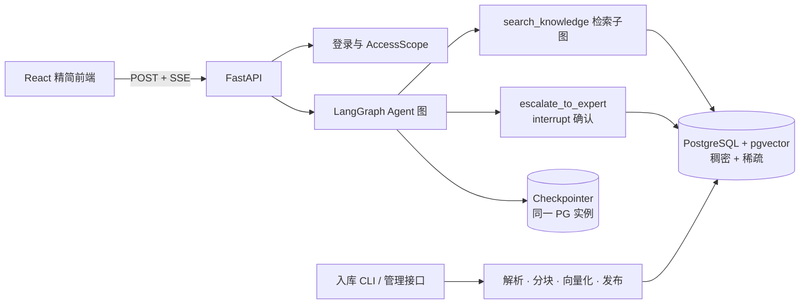

# Knoventra · 知域：权限感知的企业知识问答 MVP 方案

版本：设计稿 v3.0 · 更新日期：2026-11-01 · 状态：MVP 主流程已实现，进入质量改进 · 原工期目标：3 周（15 个工作日）

目标仓库：https://github.com/BeforeLanding/Knoventra

上游参考：[nageoffer/ragent@c3b6157](https://github.com/nageoffer/ragent/commit/c3b6157730ac1f66a312bcd286c47d3ee6aaac42)。v1.0（Java 模块扩展）与 v2.0（Python 全量重建）可通过 Git 历史回溯。

**当前实际状态（2026-11-01）：后端（检索、Agent、SSE 聊天、转交）、前端三页面与 60 例评测集已实现，并有检索层与端到端的实测结果，见 [evaluation-report.md](evaluation-report.md)；已完成本地 bge-reranker-base 检索对照，未完成：计划中的 v2-m3 实测、回答支持度人工抽查、录屏。下文第 4–11 节保留为设计，与实现不一致处以 [DECISIONS.md](DECISIONS.md) 和代码为准（例如证据闸门最终使用稠密 / 稀疏分数而非 RRF 分）。**

**当前开发分支（`feat/next-development`）：已完成显式编码保护与 val4（评测报告第 10 节）、Rerank 工程补齐和 val5 base/off 对照（第 11 节）；本轮新增回答证据快照、离线逐句审核流程，并修复繁体拒答标记（第 12 节）。130 项自动化测试通过。Rerank 默认关闭；本轮没有调用 LLM。后续优先事项为在新快照上开展真实回答的人工支持度复核、模型过度拒答分析、v2-m3 消融与录屏。**

## 1. 一句话定位

**2026-11-06 开发补齐：前端接入会话状态恢复，支持刷新后恢复待确认卡与拒答状态、过期关闭、已存决定恢复；流式请求期间禁止切换会话，离开页面取消浏览器请求。消息默认时间改为实际插入时间（迁移 `0003`）。新增前端回归及会话状态接口测试，演示步骤见 [demo-guide.md](demo-guide.md)。上述为流程改进，真实模型人工审核、v2-m3 实测与录屏仍待完成。**

**2026-11-06 下一轮：补齐逐次检索追踪与模型主动拒答标记，Agent 报告保留预期来源；新增离线 `analyze_refusals.py` 定位检索闸门拒绝、模型拒答和运行故障，并筛选目标原文命中的复核候选。仅验证诊断机制，不调整提示词 / 阈值，不新增真实 LLM 测量，不把词面命中作为过度拒答结论。使用口径见 [回答审核指南](../backend/eval/REVIEW.md)第 5 节。**

让不同区域、不同部门的员工向**自己有权看到的**公司资料提问，得到**能定位到文档版本和页码**的回答；找不到可靠依据时明确拒答，并可在确认后转交专家。

**2026-11-06 版本完整性补齐：文档唯一身份与文档行锁保护并发上传 / 发布，数据库约束保证每文档至多一个生效修订；空正文和缺失编码结果拒绝入库，空草稿不允许替换旧版，重复发布保持原时间。新增迁移 `0004`，旧实例升级后再启动服务。真实双连接并发与迁移验证见 `backend/tests/test_revision_integrity.py`；范围和限制见 [DECISIONS.md](DECISIONS.md)第 18 条。**

**2026-11-06 会话并发补齐：聊天与确认共用 PostgreSQL session advisory lock，跨标签页 / worker 的同会话写冲突在 SSE 前返回 HTTP 409 / `CONVERSATION_BUSY`，其他会话独立执行；响应和迭代器清理后释放锁，连接异常时丢弃可能持锁的 DB session。本轮不新增迁移；连接池、部署边界和取消语义见 [DECISIONS.md](DECISIONS.md)第 19 条。**

项目是对实习期间所提检索链路方案的个人独立实现：使用 Python / FastAPI / LangGraph 从零编写后端，参考 Ragent 的工程设计；全部资料、账号和业务规则为自编虚构数据，不含任职企业的代码、文档或配置。

## 2. v3.0 相对 v2.0 的调整

| 维度 | v2.0 | v3.0 |
|---|---|---|
| 场景 | 通用内网：频道、公告、IT 工单、中英双语 | 对齐实习方案：跨三地 Ops 故障手册 + 部门隔离 + 简繁体 |
| 工期 | 6–8 周，P0–P5 | 3 周，三个里程碑，每周末可演示 |
| 存储与任务 | PG + 独立 Checkpoint 库 + Redis + S3 + Celery + Outbox + ES | 单个 PostgreSQL（pgvector），同步入库，无 Redis / Celery / ES |
| 关键词检索 | P2 引入 Elasticsearch | BGE-M3 稀疏向量（或 PG 内 BM25 兜底），与稠密向量同库 |
| 记忆 | 三层记忆、删除屏障、memory_epoch | 仅会话内短期状态（LangGraph Checkpointer）；长期记忆不做 |
| 工具 | Python MCP 服务 + 3–4 个工具 | 进程内 1 个需确认的写工具（转交专家）+ 1 个只读查询 |
| 前端 | 改造 Ragent 前端 + `/api/ragent` 兼容层 | 新建精简前端，按需移植 Ragent 组件，不做旧接口兼容 |
| 评测 | 150 例 | 60 例（20 调参 / 40 留出），三组消融对照 |
| 口径 | “基于 Ragent 二次开发” | “参考 Ragent 工程设计，以 Python 重新实现” |

取舍理由：

- **与实习叙事一一对应。** 实习产出的需求梳理、分层架构、检索链路设计和演示框架（场景 A：有权限者拿到带出处的答案；场景 B：无权限或无依据时守住边界），在 v3.0 中都有对应的可运行实现和可复现的评测。
- **聚焦 RAG 本身。** Agent 主循环、上下文压缩和长期记忆已在另一个项目（mini-DSH）中实践过；Knoventra 的增量集中在权限、版本、引用、简繁检索四件事上。
- **先能演示，再谈可靠性工程。** v2.0 中的撤权传播、跨系统一致性、任务补偿等设计保留在第 12 节作为扩展方向，不进入 MVP。

## 3. 演示故事与虚构数据

### 3.1 虚构企业

“示例精密设备公司”（虚构），在 CN / TW / SG 三地设有 Ops 团队，另有 HR、FIN、IT 职能部门。所有人名、设备型号、故障码、流程与金额均为自编。

### 3.2 账号（6 个）

| 账号 | 区域 | 部门 | 用途 |
|---|---|---|---|
| `sg-ops@example.test` | SG | Ops | 场景 A 主角 |
| `tw-ops@example.test` | TW | Ops | 繁体提问 |
| `cn-ops@example.test` | CN | Ops | 区域隔离用例 |
| `hr@example.test` | SG | HR | 部门隔离用例 |
| `fin@example.test` | CN | FIN | 部门隔离用例 |
| `admin@example.test` | — | IT | 入库与发布 |

### 3.3 资料（约 12 份，Markdown + PDF 混合）

- Ops 故障手册 6 份：简体 3 份、繁体 3 份；其中 1 份有 v1 / v2 两个修订，用于验证只引用生效版本；1 份标为 CN 区限定。
- HR 制度 2 份、FIN 报销与预算 2 份：仅本部门可读。
- 公共 IT 入职指南 2 份：全员可读。
- 故障码（如 `E17-42`）、型号、步骤编号刻意设计为稠密向量不易区分的精确词，用于检验关键词通道。

### 3.4 五个演示故事

1. **场景 A**：`sg-ops` 问“E17 设备报代码 42 先查什么”，回答列出步骤，来源卡显示手册名、修订、页码、原文片段，点开预览。
2. **跨简繁**：`tw-ops` 用繁体问一个只存在于简体手册的问题，命中正确来源，原文以原字形展示。
3. **场景 B（无权限）**：`hr` 问同一个故障问题，受限手册不出现在回答、来源、预览中；`sg-ops` 问 FIN 预算，同样拿不到。
4. **场景 B（无依据）**：问一个手册未覆盖的故障，系统拒答并给出责任团队，不用常识补全。
5. **转交专家**：用户要求转人工，Agent 生成转交摘要并弹出确认卡；确认后只创建一条转交记录，重复确认或刷新恢复不会重复创建。

另含一个版本故事：管理员发布 v2 后，同样的问题只引用 v2，v1 不再被检索。

## 4. 架构



### 4.1 检索子图（确定性流程，非自治 Agent）

```text
问题 → 简繁归一化（OpenCC）→ 可选查询改写
     → AccessScope 求出可读知识库集合（空集直接返回 NO_ACCESS，不检索）
     → 稠密召回 Top-20 ┐  均在 SQL 中以 kb_id = ANY(:readable) 且 revision 为生效版本 预过滤
     → 稀疏召回 Top-20 ┘
     → RRF 融合 → Rerank 取 Top-5 → 证据闸门（最高分低于阈值则 INSUFFICIENT_EVIDENCE）
     → 返回结构化证据：chunk_id、文档、修订、页码、章节、原文片段、语言、分数
```

权限过滤发生在召回 SQL 内部，未授权的块不会进入候选集、精排或模型上下文（对应实习方案原则 1）。MVP 不做答案缓存，从而不存在跨用户缓存泄露路径（对应原则 2）；以后加缓存时键必须包含权限指纹。

### 4.2 Agent 图

LangGraph `StateGraph`，节点：

1. `load_context`：从 Checkpointer 取本会话消息，服务端注入当前用户与 AccessScope（不放进模型可改的状态）。
2. `agent`：模型决定直接回答、调用 `search_knowledge`、调用 `get_escalation_status` 或调用 `escalate_to_expert`。
3. `tools`：只读工具直接执行；写工具进入 `prepare_escalation`。
4. `prepare_escalation`：生成稳定 `operation_id` 与参数摘要并落库，调用 `interrupt()` 返回确认卡。
5. `execute_escalation`：恢复后执行，按 `(user_id, operation_id)` 唯一约束幂等写入。
6. `cite_check`：把回答中的引用标记与本轮证据注册表比对，未注册的标识不渲染为来源；回答语言跟随提问语言。

上限：每轮最多 4 次工具调用、模型调用设超时，超限给出明确失败状态。

### 4.3 简繁体处理

- 入库：保存原文；另存 OpenCC 转简体的归一化文本，用于稀疏 / 关键词匹配。
- 查询：同样归一化后做稀疏召回；稠密召回直接用原问题（BGE-M3 本身跨语言）。
- 展示：来源片段始终显示原字形；回答使用提问者的字形。
- 实习调研已指出常用解析榜单只覆盖简体，繁体效果属于盲区，因此 MVP 用评测集中的繁体用例单独报告结果。

## 5. 技术选型

| 组件 | 选择 | 备注 |
|---|---|---|
| 语言与包管理 | Python 3.12、uv | D1 在本机与 Linux 容器验证 |
| Web | FastAPI + Pydantic v2 | SSE 用 `StreamingResponse` |
| 编排 | LangGraph（`StateGraph`、`interrupt`、`Command(resume=)`）+ LangChain 模型 / 工具接口 | D1 锁定版本 |
| 数据库 | PostgreSQL 16 + pgvector（`vector` + `sparsevec`） | Docker Compose 启动 |
| ORM / 迁移 | SQLAlchemy 2 + Alembic | |
| Checkpointer | `langgraph-checkpoint-postgres` | 与业务表同实例、独立 schema |
| Embedding | BGE-M3（稠密 + 稀疏，一次编码） | 对应实习期间检索链路选型的结论；本机 CPU 跑不动时改用托管 API 稠密向量 + PG 内 BM25 兜底 |
| Rerank | bge-reranker-v2-m3（本地或托管 API） | 可关闭，作为消融项 |
| LLM | OpenAI 兼容接口的中文模型 | D1 选定并记录模型名，不在文档中预设 |
| 解析 | PyMuPDF（保留页码）、Markdown 按标题切 | 扫描件 / OCR 不在 MVP |
| 简繁 | OpenCC | |
| 前端 | Vite + React + TypeScript | 可移植 Ragent `frontend/` 的消息渲染组件并保留归属 |
| 测试 | pytest、pytest-asyncio、HTTPX | 模型调用在 CI 中 mock |

D1 的两个关键验证：pgvector `sparsevec` 对 BGE-M3 稀疏权重的存取与检索是否可行；BGE-M3 在本机的编码速度能否在几分钟内完成 12 份资料入库。任一不满足就切换到兜底方案，并记一条决策。

## 6. 数据模型（10 张表）

| 表 | 关键字段 |
|---|---|
| `knv_user` | id、email、password_hash、region、department、role、enabled |
| `knv_kb` | id、name、description |
| `knv_kb_grant` | kb_id、region（可空）、department（可空）、role（可空）；任一行匹配即可读 |
| `knv_document` | id、kb_id、title、source_lang（zh-Hans / zh-Hant / en） |
| `knv_revision` | id、document_id、version、status（DRAFT / PUBLISHED / RETIRED）、published_at、content_hash |
| `knv_chunk` | id、revision_id、kb_id、page、section_path、text、text_norm、dense `vector(1024)`、sparse `sparsevec` |
| `knv_conversation` | id、user_id、thread_id、title、created_at |
| `knv_message` | id、conversation_id、role、content、evidence_json、created_at |
| `knv_confirmation` | id、user_id、thread_id、operation_id、summary、status、expires_at |
| `knv_escalation` | id、user_id、operation_id（与 user_id 联合唯一）、summary、evidence_refs、status |

- `knv_chunk` 冗余 `kb_id`，使权限预过滤只需一次索引条件。
- 发布新修订：先写入全部新块，再在一个事务里把旧修订置为 RETIRED、新修订置为 PUBLISHED；检索只读 PUBLISHED。失败时旧版继续生效，不会半发布。
- 区域限定（如“CN 区限定手册”）用 `knv_kb_grant.region` 表达；真正的数据驻留（境内外分集群部署）不在 MVP 范围，第 12 节说明。

## 7. API 与流式事件

前缀 `/api/v1`：

- `POST /auth/login`、`GET /me`：演示登录，返回签名 token；用户身份、区域、部门只来自服务端。
- `POST /chat`：`{conversation_id?, message}`，返回 SSE。
- `POST /chat/confirm`：`{confirmation_id, approve}`，服务端校验归属、有效期与状态后 `Command(resume=...)`，返回 SSE。
- `GET /conversations`、`GET /conversations/{id}/messages`：本人会话与回放。
- `GET /evidence/{chunk_id}`：来源预览，每次重新鉴权。
- `GET /escalations/{id}`：本人转交记录。
- `POST /admin/documents`、`POST /admin/revisions/{id}/publish`：上传与发布（仅 admin）。
- `GET /debug/search?q=`：返回检索各阶段候选与分数，仅开发环境，同样受权限约束。

SSE 事件：`meta`（conversation_id、run_id）→ `status`（检索中 / 调用工具）→ `token` → `sources` → `confirm` 或 `done`；错误用 `error` 事件携带错误码（`NO_ACCESS`、`INSUFFICIENT_EVIDENCE`、`RETRIEVAL_UNAVAILABLE`、`CONFIRMATION_EXPIRED`、`RUN_LIMIT`）。

## 8. 前端（3 个页面）

- `/login`：演示账号快速切换。
- `/chat`：会话列表、流式回答、来源卡（手册名 · 修订 · 页码 · 片段，点开预览）、工具进度、确认卡、拒答态单独样式。
- `/admin`：上传资料、查看修订、一键发布新版本。

页面右上角常驻显示当前身份（区域 / 部门），便于录屏时让观众看清“换个人问同一问题”的差别。

## 9. 评测

### 9.1 评测集（60 例，随资料一起版本化）

| 类别 | 数量 | 判定 |
|---|---|---|
| Ops 故障问答（含精确故障码） | 20 | Recall@5、引用是否指向正确修订与页码 |
| 简繁交叉 | 10 | 同上，单独报告 |
| 越权（部门 / 区域） | 15 | 回答、来源、预览中出现受限块即失败 |
| 无依据 | 10 | 是否拒答，是否编造 |
| 转交流程 | 5 | 是否只产生 1 条记录；拒绝后是否为 0 条 |

前 20 例（按类别分层抽取）用于调阈值与提示词，其余 40 例留出，只在最终报告时运行。

### 9.2 指标

- 检索：Recall@5（按例宏平均）、MRR。
- 回答：引用正确率（来源存在、已授权、生效修订、支持对应论断，后者人工判定）、拒答正确率。
- 安全：越权泄露次数，目标 0；重复转交记录数，目标 0。说明这是有限用例上的结果，不代表绝对无风险。
- 延迟：检索耗时、首个答案 token 时间、整轮耗时，注明硬件与是否调用远程模型。

### 9.3 三组消融（简历数字来源）

1. 仅稠密 vs 稠密 + 稀疏（预期在故障码类问题上差异最大）。
2. 有 / 无 OpenCC 归一化（繁体问简体资料）。
3. 有 / 无 Rerank。

每组在留出集上运行，记录模型、提示词版本、资料版本与运行日期；数字以实测为准，达不到预期也如实写入报告。在线模型调用前先估算费用并显式开启，CI 只跑 mock 版本。

### 9.4 必须有的确定性测试

- 6 个账号两两交叉：每人只能检索、预览、回放自己有权的内容；猜测他人 conversation / chunk / escalation ID 返回 404。
- AccessScope 为空或权限查询异常时不检索（fail-closed）。
- 发布 v2 后 v1 的块不再被召回；发布中途失败时 v1 仍生效。
- 确认重复提交、恢复后进程重启再恢复，均不产生第二条转交记录。
- 回答中伪造的引用标识不被渲染为来源。

## 10. 三周计划

每个里程碑结束时都有一段可录屏的演示；落后时先砍第 10.4 节列出的内容，权限测试和评测不砍。

### 10.1 第 1 周：权限检索闭环（D1–D5）

- D1：uv 项目、Compose（PG + pgvector）、Alembic 空库、版本锁定；完成第 5 节的两个关键验证。
- D2：表结构、种子账号与授权、演示资料初稿（先 6 份）。
- D3：解析与分块（页码、章节）、BGE-M3 编码、发布事务。
- D4：AccessScope、稠密 + 稀疏预过滤召回、RRF；`/debug/search`。
- D5：权限交叉测试、版本切换测试。**演示：同一问题，三个账号三种检索结果。**

### 10.2 第 2 周：Agent 与引用（D6–D10）

- D6：OpenCC 归一化、Rerank、证据闸门。
- D7：LangGraph 图、`search_knowledge` 工具、Checkpointer。
- D8：`/chat` SSE、证据注册表与 `cite_check`、拒答路径。
- D9：`escalate_to_expert` 的 interrupt / resume 与幂等；`get_escalation_status`。
- D10：补全资料到 12 份并撰写 60 例评测集。**演示：curl / 简易页面跑通五个故事。**

### 10.3 第 3 周：前端、评测与交付（D11–D15）

- D11–D12：前端三页面。
- D13：在调参集上定阈值；跑三组消融。
- D14：留出集最终评测，写 `docs/evaluation-report.md`（含失败案例分析）。
- D15：README（只写已完成能力）、录屏、`docs/DECISIONS.md`（关键架构决策与替代方案）。

### 10.4 可砍清单（按顺序）

1. `/admin` 页面（保留 CLI 入库发布）。
2. Rerank（消融少一组）。
3. 查询改写。
4. 前端会话列表与回放（保留单会话）。

## 11. 目录规划

```text
backend/
  pyproject.toml / uv.lock / alembic.ini
  alembic/versions/
  src/knoventra/
    main.py          # FastAPI 应用与 lifespan
    config.py
    auth/            # 登录、token、当前用户
    access/          # AccessScope 与授权查询
    ingestion/       # 解析、分块、编码、发布
    retrieval/       # 归一化、召回、融合、精排、闸门
    agent/           # LangGraph 图、节点、工具
    api/             # 路由与 SSE 编码
    db/              # 模型与会话
  tests/
  eval/              # 评测集、运行器、报告生成
web/                 # Vite + React 前端
data/demo/           # 虚构资料、种子与授权配置
deploy/compose.yaml
```

Java 上游目录在 MVP 期间保持不动。MVP 完成后再决定是移入 `reference/` 还是通过 `.gitattributes` 标为 vendored，使 GitHub 语言统计反映 Python 实现。

## 12. 明确不做（以及以后怎么做）

| 不做 | 原因 | 扩展方向 |
|---|---|---|
| IM 通道（企业微信 / Teams / Line / WhatsApp） | 需真实企业资质与账号 | 统一知识层 + 通道适配器；先做一个 Webhook 适配器示例 |
| 数据驻留分集群部署 | 涉及法务与基础设施 | 境内外各一套实例，跨区仅同步脱敏后的知识 |
| 撤权后的在途运行中止、旧 Checkpoint 隔离 | MVP 每次请求重新计算 AccessScope 已覆盖主要读取路径 | v2.0 第 5.4 节的权限版本与状态代次方案 |
| 异步入库（Celery / Outbox）、ES | 资料量小，同步入库足够 | PG Outbox + Worker；ES 作为独立关键词通道对照 |
| 长期记忆 | 与本项目主线无关 | 用户命名空间事实仓储，默认关闭 |
| MCP 服务化 | 进程内工具足以演示确认与幂等 | 把转交工具迁到独立 MCP 服务，执行端二次鉴权 |
| OCR、复杂表格、父子分块 | 解析选型需真实样本 | MinerU / PaddleOCR-VL 实测，尤其繁体扫描件 |

## 13. 与实习工作的关系

### 13.1 方案设计与个人实现的对应

| 实习期间的方案设计 | Knoventra 中的实现与验证 |
|---|---|
| 需求拆解：Ops 跨区共享、HR/FIN 不泄露 | 区域 + 部门授权模型，越权用例 0 泄露 |
| 原则 1：权限在检索时生效 | SQL 预过滤 + fail-closed + 交叉测试 |
| 原则 2：缓存须以权限为键 | MVP 不缓存答案，并记录加缓存时的键设计 |
| 检索链路选型：BGE-M3 混合检索 + Rerank + 块级引用 | 稠密 + 稀疏 + RRF + Rerank，消融对照 |
| 选型调研：繁体解析与检索效果未经验证 | OpenCC 归一化与繁体专项评测 |
| 演示框架：场景 A / 场景 B、转交专家 | 五个演示故事与确认幂等 |
| 检索链路设计：引用回查权限与版本 | 证据注册表、生效修订、预览逐次鉴权 |

### 13.2 表述边界

- 实习期间的成果是技术调研、架构与检索链路方案、演示框架，属方案设计；Knoventra 是在个人时间、用虚构数据完成的独立实现。两者分开陈述，不把个人实现说成公司已上线系统。
- 简历中的数字只来自第 9 节的实测报告，并注明数据规模（12 份资料、60 例）。
- 参考 Ragent 的设计与移植的代码在 README 与 THIRD_PARTY_NOTICES 中如实说明。

## 14. 完成定义

- 干净环境按 README 用 `docker compose` + `uv` + 种子脚本启动，无需任何企业或 Java 服务。
- 五个演示故事与版本故事全部可在前端复现，并有录屏。
- 第 9.4 节确定性测试全部通过；越权泄露与重复转交为 0。
- 留出集评测报告包含环境、配置、三组消融、失败案例与实测值。
- README、DECISIONS 与代码状态一致，未完成的能力不写成已完成。

## 附录：参考

- [Ragent 固定提交](https://github.com/nageoffer/ragent/commit/c3b6157730ac1f66a312bcd286c47d3ee6aaac42) 与 [保留的上游介绍](../README.upstream.md)。
- [LangGraph 中断与恢复](https://docs.langchain.com/oss/python/langgraph/interrupts)、[持久化](https://docs.langchain.com/oss/python/langgraph/persistence)。
- [pgvector](https://github.com/pgvector/pgvector)（`sparsevec` 类型）、[BGE-M3](https://huggingface.co/BAAI/bge-m3)、[OpenCC](https://github.com/BYVoid/OpenCC)。
- 依赖的具体版本与接口行为以 D1 锁定和实测为准。
