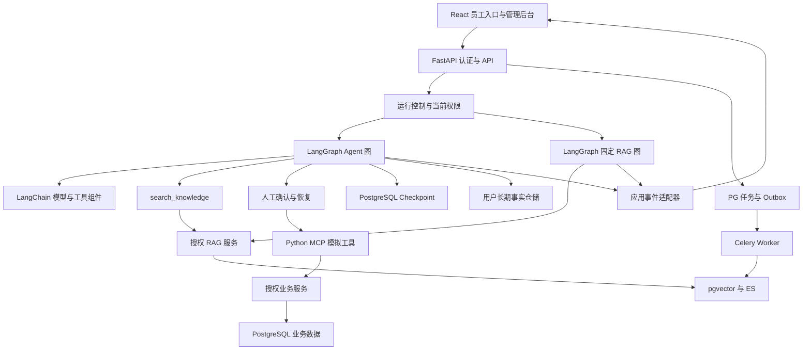

# Knoventra · 知域：Python 版企业内网知识助手二次开发方案

版本：设计稿 v2.0 · 更新日期：2026-10-27 · 状态：待实施

目标仓库：https://github.com/BeforeLanding/Knoventra

架构决策：以 Python + FastAPI + LangChain + LangGraph 重建后端，复用 React / TypeScript 前端及可兼容基础设施。Ragent 作为功能、工程设计和测试行为的参考基线。

上游基线：[nageoffer/ragent@c3b6157730ac1f66a312bcd286c47d3ee6aaac42](https://github.com/nageoffer/ragent/commit/c3b6157730ac1f66a312bcd286c47d3ee6aaac42)，提交日期 2026-10-25。v1.0 设计可通过 Git 历史回溯。

**当前实际状态：仓库仍是导入的 Java 上游源码与设计文档，尚无 Python 后端实现。下述新目录、接口、迁移、容器和指标均为计划，没有完成依赖安装、应用构建或端到端验证。**

阅读导航：

- 产品与迁移：[项目定位](#1-项目定位与交付边界)、[上游与选型](#2-上游基线与技术选型)、[业务故事](#3-业务角色与演示故事)。
- 核心链路：[Python 架构](#4-python-目标架构与业务流程)、[权限](#5-权限模型与撤权处理)、[RAG](#6-rag-入库检索与证据链)、[记忆](#7-分层记忆与上下文治理)、[工具与确认](#8-mcp-模拟工具与人工确认)。
- 工程实现：[数据迁移](#9-数据模型持久化与迁移)、[API 与事件](#10-api-兼容与流式事件协议)、[前端](#11-前端信息架构与交互)、[数据隔离](#12-演示数据与公开边界)、[任务与部署](#13-后台任务部署与可观测性)。
- 交付管理：[测试评测](#14-测试评测与验收标准)、[阶段计划](#15-分阶段实施计划)、[首批任务](#16-首批可执行任务)、[风险](#17-风险与取舍)、[许可与完成定义](#18-仓库管理许可与完成定义)。

## 1. 项目定位与交付边界

Knoventra 将制度、部门资料、公告与操作手册组织成可查询、可引用、遵守权限的知识助手。员工能查询流程要求，也能在同一对话中查看模拟申请状态、确认后创建演示 IT 工单。

业务抽象来自常见内联网需求：部门频道、内容发布、员工身份、多语言和知识问答。个人项目独立编写实现和资料，不复制任职企业的源码、文档、品牌、账号或基础设施配置。

### 1.1 首版范围

- 一个虚构企业、多个部门和知识库，不承诺完整 SaaS 多租户能力。
- 员工制度、财务指引、IT 手册、安全规范、公共公告五类内容。
- 员工问答、跨库检索、管理员入库、修订发布、原文预览和来源追踪。
- 知识库级 ACL；库内资料继承权限，细粒度差异通过拆库处理。
- 固定 RAG Workflow 与动态 Agent 两个入口，首版主界面使用 Agent。
- 中英文提问 / 回答，保持原文语言、修订和生效时间可追溯。
- 公告查询、本人模拟申请进度、需确认的模拟 IT 工单创建。
- 用户级短期状态、历史摘要与可关闭 / 删除的长期记忆。
- 可在个人资源上重建的演示数据、环境和评测集。

### 1.2 延后内容

马来语 / 泰米尔语、图谱、Milvus、多模态、阅读回执、文档级 ACL、企业 SSO 和真实业务连接器作为独立扩展。首版不重建完整新闻 / 视频门户、短信平台、人事主数据或真实审批引擎。

### 1.3 本次技术路线调整

v1.0 的“Maven 模块内增加业务”由 Python 后端重建取代：身份、业务 API、RAG、入库、运行控制、SSE、记忆与工具集成都需 Python 实现。数据库和前端可有选择复用，Java 序列化状态与 AgentScope 生命周期不可直接迁入 LangGraph。

个人贡献聚焦四个可验证增量：权限贯穿检索与上下文；知识版本一致性；知识与事务工具协同；跨语言和记忆的可重复评测。框架切换本身不替代这些工程成果。

## 2. 上游基线与技术选型

### 2.1 已核对的现有代码

- `pom.xml`：Java 17、Spring Boot 4.1.0、AgentScope 2.0.2；这些是上游参考栈，不是 Python 运行依赖。
- `frontend/package.json`：React 18 / TypeScript / Vite 5 / Zustand，可复用。
- `bootstrap/src/main/resources/application.yaml`：端口 9090、前缀 `/api/ragent`、默认 Agent 档；向量启用，ES、图谱和联网搜索默认关闭。
- 上游全局角色为 `admin` / `user`，不能把完整部门 ACL 当作已有能力。
- Agent 知识门面返回合成字符串，需补充结构化来源；上游 Agent 主模型与 Workflow 模型调度不是同一容错链。

### 2.2 Python 目标组件

- Python 3.12：作为初始验证目标，P0 在本机和 Linux 容器验证兼容性。
- FastAPI + Pydantic：HTTP API、校验模型、认证依赖、流式响应与生命周期。
- LangChain：Chat Model、消息、工具、结构化输出和供应商集成；`create_agent` 可作原型与对照。
- LangGraph：StateGraph、条件边、状态检查点、暂停 / 恢复与流式运行；正式业务维护一套主循环。
- SQLAlchemy 2.x + psycopg + Alembic：业务数据访问与迁移；并行异步任务使用独立 Session。
- PostgreSQL + pgvector：业务、证据、任务与向量；Checkpoint 使用独立存储边界。
- Redis：登录会话、运行租约、取消通知和配额，不作为业务事实的唯一记录。
- Celery + Redis broker：解析、索引、记忆学习与清理；Worker 在 Linux 容器运行。
- S3 兼容存储：个人环境保存原文，下载由授权接口代理。
- Elasticsearch：基础问答完成后加入关键词通道，形成双路检索。
- Python MCP 服务与客户端适配层：提供内网模拟工具，版本与鉴权在 P0 / P3 验证。

依赖在 `backend/pyproject.toml` 声明、`backend/uv.lock` 锁定。本文不虚构已测试版本；P0 形成 LangChain / LangGraph / Checkpoint / MCP / Python 的兼容组合，之后固定版本升级。首版不依赖付费托管 Agent 服务。

LangChain 提供 Agent 与模型 / 工具组件，LangGraph 提供编排运行时；本方案据此划分职责。[LangChain 官方定位](https://docs.langchain.com/oss/python/langchain/overview)、[LangGraph 官方定位](https://docs.langchain.com/oss/python/langgraph/overview)

### 2.3 Java 职责的迁移去向

- `framework` 的上下文、异常、SSE、取消：重建到 `core`、`api`、`runtime`。
- `infra-ai` 的模型、Embedding、Rerank：重建到 `providers`，应用另实现超时、限流与容错。
- `system` 的身份、用户、审计：重建到 `auth`、`permissions` 和仓储。
- `rag` 的重写、意图、检索、入库：重建到 `rag`、`ingestion`。
- `agent` 的运行、确认、状态、记忆：重建到 `graphs`、`runtime`、`memory`。
- `bootstrap` 的装配：改由 FastAPI lifespan、Settings 和依赖注入负责。
- `mcp-server`：独立编写 Python 模拟服务，Java 示例保留参考。
- 内网业务：`intranet` 负责部门、频道、公告、资料修订和模拟工单。

首版部署为 API + Worker + MCP 服务，代码按领域组织，不拆大量微服务。检索和图编排依赖权限服务接口，避免反向依赖具体门户 API。

### 2.4 现存源码参考

以下仅用来核对上游行为，不表示继续在 Java 中实施：

- `agent/src/main/java/com/nageoffer/ai/ragent/agent/config/ReActAgentProvider.java`：运行时装配。
- `agent/src/main/java/com/nageoffer/ai/ragent/agent/service/impl/AgentChatServiceImpl.java`：发起、确认、收尾。
- `agent/src/main/java/com/nageoffer/ai/ragent/agent/tool/KnowledgeSearchTool.java`：知识工具契约。
- `rag/src/main/java/com/nageoffer/ai/ragent/rag/service/KnowledgeSearchFacade.java`：知识工具内部链路。
- `rag/src/main/java/com/nageoffer/ai/ragent/rag/core/retrieval/channel/RetrievalScopeResolver.java`：定向、回退、补充范围。
- `agent/src/main/java/com/nageoffer/ai/ragent/agent/memory/`：裁剪、压缩和事实管理。
- `resources/database/schema_pg.sql`：上游业务 / 状态表；Python 新环境不执行这份全量脚本。
- `frontend/src/services/api.ts`、`frontend/src/services/agentService.ts`、`frontend/src/router.tsx`：认证头、接口和页面兼容。

## 3. 业务角色与演示故事

### 3.1 角色与权限

员工查看公共及已加入频道、自己的会话与申请。频道维护者额外管理被授权频道和知识库。平台管理员配置系统、账号和授权；跨部门资料访问使用单独管理权限并留审计。

保留 `admin` / `user` 作为对外平台角色；频道关系记录 `reader` / `maintainer`，避免把部门名编码为全局角色。用户、启用状态、部门与权限来自服务端，不能由模型或客户端声明。

### 3.2 五个必备故事

1. 入职员工问办公环境配置：查 IT 手册，返回操作、适用对象和来源修订。
2. 同时问报销材料与设备借用：拆分财务、IT 子问题，在可读库检索。
3. VPN 故障：先查指引再补充信息，确认后仅创建一条工单，可继续查进度。
4. 中文问英文制度并用英文追问：答案语言可切换，引用仍对应原文。
5. 新制度发布或成员被移除：旧索引、缓存、摘要、Checkpoint 不继续提供失效资料。

制度编号用 `POL-DEMO-001`，账号用 `employee-a@example.test` 等虚构标识；金额、流程与时限自编，不用于实际企业决策。

## 4. Python 目标架构与业务流程

### 4.1 计划目录

以下目录均待创建，本次不移动或删除 Java 源码与历史：

```text
backend/
  pyproject.toml
  uv.lock
  alembic.ini
  alembic/versions/         # Python 业务库迁移
  src/knoventra/
    main.py                # FastAPI 与 lifespan
    core/                  # Settings、错误、日志、时间、ID
    api/                   # 原生 API、兼容路由、SSE 编码
    auth/                  # 登录会话、用户依赖
    permissions/           # AccessScope、权限版本
    providers/             # 模型、Embedding、Rerank、存储适配
    graphs/                # Agent / Workflow 状态与节点
    runtime/               # 锁、取消、恢复、事件适配
    rag/                   # 重写、路由、召回、融合、证据
    ingestion/             # 获取、解析、分块、版本索引
    memory/                # 预算、摘要、事实、删除
    intranet/              # 频道、公告、模拟工单
    persistence/           # 业务模型、仓储
    workers/               # Celery 任务、调度、补偿
    mcp_server/            # Python MCP 与模拟工具
  tests/                   # 单元、集成、契约、恢复测试
  scripts/                 # 演示种子、索引、评测入口
deploy/                    # Python Compose 与配置示例
frontend/                  # 复用后逐步适配
resources/demo/knoventra/   # 原创资料与评测数据
```

### 4.2 组件关系



### 4.3 唯一的主 Agent 循环

自定义 StateGraph 表达：入口校验 → 加载允许使用的历史 / 记忆 → 控制上下文 → 模型决策 → 工具策略检查 → 只读工具或待确认节点 → 执行 / 观察 → 回到决策；无需工具时进入引用检查和结束节点。

LangChain 提供消息、模型和工具；`create_agent` 用于 P0 原型或对照，正式图不再嵌套另一套独立 Agent 循环。知识工具调用确定性检索子图，不另建自治 Agent。

每次模型前重验上下文与授权；工具前校验参数和范围；证据输出前校验版本。模型不能修改身份、授权版本、步骤上限或工具白名单。配置模型超时、每轮工具预算与最大迭代，失败路径有明确状态。

### 4.4 状态与运行时上下文

Graph State 保存消息、摘要、证据引用、待确认操作 ID、步骤数、知识版本、已处理消息序号和状态 Schema 版本。只保存可序列化数据，不保存数据库 Session、HTTP 客户端、连接或凭据。

运行时上下文包含认证主体、当前 AccessScope、截止时间、取消检查与追踪 ID，由服务器构造。Checkpoint 的旧身份 / 权限元数据仅用于比对；恢复时必须重新读取当前权限。

`conversation_id` 对应用户可见会话；`thread_id` 为服务端生成、绑定所有者的 Checkpoint 标识；`run_id` 标识一次用户任务，可跨多次确认；`attempt_id` 标识实际执行尝试；`operation_id` 标识一次副作用。客户端提交 thread ID 不构成读取或恢复授权。

### 4.5 Workflow、并发与取消

固定图为重写 / 拆分 → 意图 → 授权检索 → 证据校验 → 回答，用于可控入口与评测对照，不增加一个模型分类器来猜执行引擎。两入口共用权限和知识服务。

每个 thread 同时最多一个活跃运行；跨进程锁带租约与 fencing token，防止旧执行者在租约过期后继续提交。每用户并发、全局模型额度与运行时限独立控制，不能只用进程内信号量。

业务 run 状态定义为 QUEUED、RUNNING、WAITING_CONFIRM、COMPLETED、FAILED、CANCELLED、EXPIRED；恢复确认后进入 RUNNING 并增加 attempt_id。状态转换经版本检查提交，HTTP done 事件不是独立业务终态。进程崩溃留下的过期租约由监管任务标记并对账，恢复前重新验证权限与可执行节点。

取消先写服务端标志并通知运行者，在模型、节点和工具边界协作停止；超时再取消协程。阻塞 SDK 的线程不保证能被取消，业务写入必须查询真实结果；停止生成不承诺撤销已提交操作。

### 4.6 生命周期与图版本

FastAPI lifespan 管理数据库池、模型 / HTTP 客户端、Checkpointer 和 MCP 客户端；请求与并行任务使用独立业务 Session。建表和 Checkpoint setup 在受控迁移步骤执行，不让各 API Worker 启动时并发迁移。

记录 `graph_version` / `state_schema_version`。升级前验证待确认与可恢复 thread；不兼容时完成旧图运行、显式迁移或终止后新建会话，不能直接让新节点解释旧状态。设计依据见 [Graph API](https://docs.langchain.com/oss/python/langgraph/graph-api)。

## 5. 权限模型与撤权处理

### 5.1 授权规则

公共频道向有效演示员工开放；成员频道通过关系授权。知识库绑定频道后继承授权主体并集，维护权限单独判断。同库同权限，敏感级别不同的资料拆库。

AccessScope 包含当前用户、可读库、可维护频道、递增 `acl_version` 和解析时间。输入库 ID 只能与范围求交；空范围和权限服务故障均不能回退为全部库。

### 5.2 授权范围与意图范围

Python scope resolver 把 active、target、supplement 集合都限定在可读库。“全局回退”仅表示当前员工全部可读库，低置信度、悬空绑定、通道故障不扩大权限。

PG / ES 在查询阶段过滤授权范围，再取 TopK；Rerank、模型和证据登记仅接收合格候选。图谱不能可靠绑定来源和 ACL 时保持关闭。

### 5.3 所有读取出口

- 文档与引用预览通过后端逐次鉴权，不暴露绕过应用的存储裸 URL。
- 缓存键包括权限集合指纹或用户、ACL / 知识版本、语言、模型和提示词版本。
- 历史、摘要、工具结果与证据附带文档 / 修订依赖；权限变化后过滤历史、废弃旧摘要并重建状态。
- 暂停确认在恢复前重新鉴权，参数范围或工具权限变化即失效。
- 管理、导出、统计、Trace 和错误提示也不能暴露不可读资料。

### 5.4 Checkpoint 的撤权风险

旧 Checkpoint 是资料副本，不对用户开放任意 Checkpoint / time-travel API。恢复、回放和调试入口均检查 owner、ACL 与状态版本。撤权后建立新状态代次、禁止旧分支恢复，旧 Checkpoint 清理或按策略隔离。

节点执行和事件发送检查权限版本，变化后停止后续输出并按当前权限重建。已发送、下载的资料不可撤回；验收范围是阻断后续读取、模型输入与输出。

## 6. RAG 入库检索与证据链

### 6.1 Python 入库与修订

Python 实现获取、解析、清洗、分块、富化与索引。首版支持文本 / Markdown、PDF、DOCX；解析器候选为 pypdf / python-docx 与标题感知分块，按固定夹具验证。扫描 PDF / OCR、复杂表格与原 Tika 格式覆盖不自动视为等价。

元数据包含业务文档、修订、语言 / 源语言、标题、频道、知识库、发布 / 生效 / 失效时间、内容哈希和索引代次。发布状态为 `DRAFT -> INDEXING -> PUBLISHED -> RETIRED`，失败为 `INDEX_FAILED`；入库任务状态另记。

同文档同语言同一时刻仅一个活动修订，未来制度不提前检索。翻译关联源修订，不覆盖原文。Chunk 保留标题、编号和表格上下文；父子分块是后续独立实验。

### 6.2 索引一致性

新修订先生成分块和双通道索引，所有启用通道水位达到新代次后才事务切换活动修订。旧索引异步清理，查询回表复核；停用 / 删除先阻断读取，再清派生数据。

发布与 Outbox 在同一 PG 事务提交，Celery 接收任务 ID 后幂等执行。PG、ES、存储和 broker 不存在自动跨系统事务，需记录重试、租约、错误和水位。失败保留上一已发布版，不半发布新版本。

### 6.3 检索子图

KnowledgeSearchService 接收问题、服务端 AccessScope、语言与取消上下文：词映射 → 重写 / 拆分 → 树形意图 → 授权路由 → 双通道召回 → 去重 → 加权 RRF → Rerank → 证据过滤 → 修订 / 权限复核 → 结构化返回。

重写和意图输出经 Pydantic 校验，限制子问题数与候选规模；模型不能直接生成执行用 SQL / ES 授权过滤表达式。

- 默认 PG + pgvector，P2 加入 ES 后才宣称双路混合检索；Milvus / 图谱不是首版必需依赖。
- 保留编号、错误码和专名精确匹配，维护中英文映射，跨语言 Embedding 效果需实测。
- 按 ID / 修订 / 语言 / 哈希去重，保留通道归因，不跨权限缓存原始结果。
- 预算以 20 / 40 / 10（每通道 / 精排候选 / 最终证据）作初始对照，不认定为最佳值。
- 有界异步 IO 做召回与超时，阻塞 SDK 放线程或 Worker；并行任务不共用 SQLAlchemy AsyncSession。[异步 Session 约束](https://docs.sqlalchemy.org/en/20/orm/extensions/asyncio.html)
- 无答案、通道全故障、授权失败和精排不可用区分内部状态，制度缺证据时不靠常识补全。

上游证据闸门按批次最高精排分判断、无分可放行；Python 版独立设计缺分策略与阈值，按语言 / 模型校准，不把精排分当作通用可信概率。

### 6.4 知识工具与证据

新 search_knowledge 返回 KnowledgeSearchResult：状态、授权证据、可选摘要、Trace 和知识版本。Evidence 包含服务端证据标识、文档 / 修订 / Chunk、语言、标题、片段与生效时间。

Python Agent 默认消费结构化证据并自行合成最终回答，不强制知识工具每次另调合成模型；若启用独立摘要则单独计费。Workflow 直接使用同一检索结果生成回答。

run 证据注册表约束可引用标识，适配器缓冲并校验跨 Token 的引用，模型编造的标识不渲染为有效来源。严格制度回答可完整校验后展示，并报告延迟；结构校验不能代替事实支持度评测。

重连与回放从持久化映射恢复证据，再检查当前授权和活动修订。保留来源语言 / 版本，不把内部存储地址或未经授权 ID 暴露在答案中。

## 7. 分层记忆与上下文治理

### 7.1 三层职责

短期记忆：Graph State 与 PostgreSQL Checkpointer 保存 thread 级消息和流程进度；开发测试可用内存实现，个人演示和恢复验证使用持久化实现。

中期记忆：Python ContextBudgetService、裁剪和摘要节点维护当前模型可见历史；Checkpoint 负责保存状态，不自动完成合理压缩。

长期记忆：按用户命名空间保存稳定事实和偏好。首版使用独立 PG 事实仓储，若节点需要 LangGraph Store 接口，通过适配层访问同一份数据，不同时维护两套事实。跨会话存储与 thread 检查点分工见 [持久化](https://docs.langchain.com/oss/python/langgraph/persistence)；上下文管理方式参考 [Memory](https://docs.langchain.com/oss/python/langgraph/add-memory)。

### 7.2 模型输入预算

上游使用字符阈值；Python 新版按选定模型的 Token 窗口和应用预算管理，记录估算值与供应商实际 Usage 的区别。Token 预算包含系统提示、工具 Schema、用户事实、历史、证据及预留输出，不能只数 messages 的正文。

初始设定可用预算 50% 后裁剪、80% 后尝试摘要、保留近期约 20% 的原文，均为应用层调参起点，不是 LangGraph 默认值或通用最优值。保护当前问题、未闭合 tool call / result 和确认状态；摘要保留用户目标、限制、已尝试步骤与未完成操作。

摘要只在安全轮次边界生成，期间不让另一运行修改 thread。成功后以确定性消息 ID 或版本替换历史，避免 reducer 重复追加；失败不先删原文。单次工具输出设长度上限，当前轮过大时截断可裁剪内容或明确失败，不无限烧模型窗口。

### 7.3 长期事实与抽取

允许保存明确的语言、回答详略偏好和非敏感持续任务。密码、证件号、私人联系方式、同事隐私、检索文档正文不持久化为用户事实。部门和权限由数据库决定；制度与申请状态当次查询，不用旧记忆代替。

长期记忆默认关闭，用户主动开启。自动抽取、主动 memory 工具和注入都经过开关与内容策略；不能只在提示词里约束。Celery 按已完成消息游标增量抽取，处理用户锁、版本检查和事务提交；来源消息、表达时间、事实状态与冲突更新保留审计。

消息是显示记录，摘要是模型视图，长期事实是跨会话资料，三者有独立生命周期。首版无需默认增加长期事实向量库，按用户读取有限条目并控制注入预算；语义召回作为容量增长后的独立选择。

### 7.4 删除与恢复安全

- 查看、删除单条和清空接口只操作当前用户；关闭开关立即停止抽取和注入。
- 删除在事务内递增 `memory_epoch` 并建立游标屏障；Worker 提交前比较开关与 epoch，防止旧任务把事实写回。
- 单条删除记录来源 / 语义抑制标识；用户撤销后不能仅靠下一次合并再次自动复活。
- Checkpoint 可能包含历史注入的事实，删除后清理状态视图、失效旧代次，恢复节点重读当前事实；不能只删除长期表一行。
- 权限变化按第 5 节重建上下文，检查点、摘要和记忆都不能成为绕过入口。
- 保留期初始目标为会话 30 天、审计元信息 90 天；暂停中的确认先结算或过期，再清理相关状态。清理覆盖旧 Checkpoint、派生摘要、缓存与备份策略。

## 8. MCP 模拟工具与人工确认

### 8.1 工具清单与适配

- `search_knowledge`：应用内工具，调用授权检索子图，返回结构化证据。
- `list_announcements`：MCP 只读工具，分页读取用户可见频道的已发布公告。
- `get_request_status`：MCP 只读工具，查询本人演示工单，不以猜中编号代替授权。
- `create_it_request`：MCP 写工具，创建模拟 IT 工单，执行前必须确认。

P0 固定客户端 / 服务端版本；当前官方提供的 `langchain.mcp.MCPAdapter` 属 beta，文档要求 `langchain[mcp]>=1.4.0`。优先验证该接口并封装应用适配层；若兼容性不满足，用独立决策记录选择固定兼容版本，不把历史 `langchain-mcp-adapters` 示例视为当前必需接口。[官方 MCP 文档](https://docs.langchain.com/oss/python/langchain/mcp)

MCP 采用 Streamable HTTP 或本地测试传输；客户端启动、工具发现、断开和重试由资源生命周期管理。只发布本业务工具，不默认加载原电商示例。工具目录按权限筛选，但执行端仍二次鉴权。

### 8.2 身份与参数

用户身份从 API 认证上下文传给工具调用，模型参数不能携带可自报的管理员或用户身份。到 MCP / 业务 API 的服务请求使用短时、限用途的签名身份信息，校验签发方、受众、有效期与请求归属；不能因服务位于 localhost 就放开权限。

工具参数用 Pydantic 校验类型、长度与业务范围，未知参数拒收。返回状态、记录、更新时间与受控链接，区分参数不足、依赖故障与无访问权；外部提示不暴露不可见记录的存在性。

### 8.3 interrupt 与恢复流程

准备操作节点先生成并持久化稳定 operation_id、规范化参数摘要、当前用户、run / tool call、到期时间和 ACL 版本。确认节点调用 `interrupt()` 返回可展示内容；API 适配成确认卡后结束当前 HTTP 流，不长期占着一个等待协程。

恢复请求仅提交 confirmation_id 和同意 / 拒绝。服务端检查 owner、有效期、当前权限、参数摘要与待确认状态，校验通过才构造 LangGraph `Command(resume=...)`，使用同一 thread 继续该 run，attempt_id 递增。客户端不能直接提交任意 Command 或替换工具参数。[官方中断与恢复](https://docs.langchain.com/oss/python/langgraph/interrupts)

中断恢复会重入相关节点，interrupt 前的代码不能含无保护的外部写入。确认节点保持纯读取 / 幂等准备，真正业务写入放在后续单独节点，以稳定 operation_id 去重。

### 8.4 副作用与一致性

数据库以用户 + operation_id 唯一约束保存工单，业务写入与操作结果在一个事务内提交。模型重试、确认重试、图重放都先查已提交结果，重复调用返回同一业务记录。

Checkpoint 和业务事务不是同一个自动原子提交：若工单成功而检查点写入失败，恢复时按 operation_id 找回结果，不能再创建。外部系统也必须支持幂等键或查询 / 补偿；框架持久化不等于外部 exactly-once。

用户拒绝后不提交；取消和请求超时不自动回滚已经完成的写入。界面区分未提交、提交中、已提交和结果待核对，超时后主动查询状态，避免靠异常推断“没发生”。

## 9. 数据模型持久化与迁移

### 9.1 两类存储与数据所有权

Python 业务库独立命名为 `knoventra`，由 SQLAlchemy / Alembic 管理。Checkpoint 使用同一 PostgreSQL 实例中的独立数据库 `knoventra_runtime`，后端候选为 `langgraph-checkpoint-postgres` 的 AsyncPostgresSaver，按 P0 锁定版本管理内部表。初始化、升级与清理单独执行，不手工把检查点表当业务消息表改写。

用户可见会话和消息由业务表作为唯一显示来源；Graph State 是执行状态。运行事件持久化后幂等投影为消息，使用唯一事件 ID / 序号去重；失败通过运行记录对账，不能让前端分别拼两套互相冲突的消息来源。

### 9.2 业务逻辑表

以下 `knv_` 名称为计划，尚无 DDL：

- `knv_user`、`knv_department`、`knv_user_department`：身份、有效状态、部门关系。
- `knv_channel`、`knv_channel_member`、`knv_channel_kb`、`knv_permission_revision`：频道、成员角色、知识库绑定与授权版本。
- `knv_knowledge_base`、`knv_document`、`knv_document_revision`、`knv_chunk`：库、业务文档、语言修订和分块。
- `knv_document_vector`：向量与 Embedding 模型 / 维度版本，关联修订和 Chunk。
- `knv_ingestion_job`、`knv_index_watermark`、`knv_outbox_event`：入库状态、通道水位、待派发事件。
- `knv_post`、`knv_it_request`、`knv_tool_operation`：公告、模拟工单、操作幂等结果。
- `knv_conversation`、`knv_message`、`knv_run`、`knv_run_event`：会话、显示消息、运行、事件序列。
- `knv_confirmation`、`knv_run_evidence`：确认参数摘要、期限 / 状态，来源证据与修订映射。
- `knv_user_preferences`、`knv_user_memory`、`knv_memory_cursor`、`knv_memory_tombstone`：用户开关、事实、抽取游标、删除屏障。
- `knv_audit_event`、`knv_model_usage`：操作元信息、模型请求和费用依据。

新 ID 使用 UUID 并作为 JSON 字符串返回；前端不依赖 Snowflake 算法。导入时单独维护旧新 ID 映射。时间存 UTC 的有时区类型，API 用含时区 ISO 8601；展示时由用户时区转换。

唯一约束覆盖频道成员、文档语言修订、Chunk 代次、工具 operation_id、run 事件序号和 Outbox 幂等键。索引覆盖授权查询、活动修订、待执行任务和用户工单。

### 9.3 与上游数据的迁移规则

Python 新环境从 Alembic 空库迁移和自编种子启动，不混跑上游全量 SQL、Java 升级脚本和 Python 迁移。

只需要演示时不做旧数据迁移。若迁移公开上游测试数据，编写显式 ETL：只读源库 → 字段 / ID 映射 → 内容审核 → 目标事务 → 数量、关联、抽样内容校验 → 生成导入报告。未经授权映射的库默认不可读，用户账号与密码不直接搬用。

Java 的 `t_agent_state`、框架消息序列化、确认状态和检查点不能直接复制成 LangGraph 状态；旧显示消息可只读归档或经脱敏映射导入，恢复执行始终新建 thread。

Embedding 模型、维度、分块策略、修订或 ACL 元数据变更时重新生成索引，不能把“数据库可连通”当作向量可复用。上游 SQL 继续保留作参考。

### 9.4 迁移与回滚

Alembic revisions 放在 `backend/alembic/versions/`，审查自动生成差异和数据迁移，已执行 revision 不原地改写。Checkpoint 后端初始化单列启动步骤；其版本升级要验证旧暂停状态。

迁移先在个人测试库验证空库安装、升级、备份恢复与降级边界；破坏性数据变更通过备份 / 前向修复处理，不承诺所有 downgrade 无损。Python 切换前保留旧库快照和前端路由回退配置。[Alembic 迁移机制](https://alembic.sqlalchemy.org/en/latest/tutorial.html)

## 10. API 兼容与流式事件协议

### 10.1 原生接口与兼容层

原生前缀为 `/api/knoventra/v1`；适配阶段提供 `/api/ragent` 兼容路由，复用同一 Python 业务服务，不让 Java 与 Python 同时写同一会话或数据库。

已核对旧前端：Axios 请求带 Authorization 原始 token，响应期望 `code="0"`、message、data；登录是 JSON username / password。新 API 采用规范的 Bearer 头，兼容层在限定期限接受旧头格式并映射响应、camelCase DTO、分页和字符串 ID。

首版登录使用密码哈希和服务端可撤销的随机会话 token：Redis 保存 token 哈希与用户 / 期限，注销、停用立即失效，限制登录尝试；不直接复用 Sa-Token。密码哈希候选为 Argon2，P0 固定库与参数。凭据不进入 URL、Checkpoint、日志或模型。前端存储方式与鉴权拦截器是显式改造项。

### 10.2 核心原生 API

- `POST /auth/login`、`POST /auth/logout`、`GET /me`：用户与会话。
- `POST /agent/runs`：JSON 提问，返回 SSE，meta 首事件包含 run / conversation 标识。
- `POST /agent/runs/{id}/resume`：确认恢复，重新校验身份后继续同一任务，返回 SSE。
- `POST /agent/runs/{id}/cancel`、`GET /agent/runs/{id}`：取消与状态查询。
- `GET /conversations`、`GET /conversations/{id}/messages`：列表与回放；标题和删除有对应写接口。
- `GET /me/scope`、`GET /channels`、`GET /channels/{id}/posts`：可见范围与公告。
- `POST /channels/{id}/posts`、`POST /posts/{id}/publish`：授权内容维护。
- `PUT /channels/{id}/members`、`PUT /channels/{id}/knowledge-bases`：成员和绑定管理。
- `POST /knowledge-bases/{id}/documents`、`GET /ingestion-jobs/{id}`：上传与后台任务。
- `GET /documents/{id}/revisions`、`GET /documents/{id}/content`：修订 / 原文代理读取。
- `GET /requests/{id}`：本人模拟工单；MCP 写入走受保护的内部业务入口。
- `GET /me/memories`、`DELETE /me/memories/{id}`、`DELETE /me/memories`、`PATCH /me/preferences`：记忆与语言。

上述路径均相对于原生前缀，完整鉴权、参数与 DTO 在 P0 OpenAPI 契约中定义。首版只承诺当前展示流程依赖的旧管理接口兼容；未覆盖接口明确关闭，不宣称全量前端零改动。

### 10.3 旧流式协议的适配

已核对上游事件为 meta、message、block、hint、confirm、finish、done、cancel。适配器把 LangGraph 事件、工具状态和中断转换成这套应用协议，再新增 `knowledge_sources`，不能把图框架原始事件直接交给旧前端解析。

meta 先于业务增量；confirm 表示等待确认，本次流不同时发 finish；done 表示 HTTP 流结束而非任务必然成功。错误沿兼容协议通过 message 的错误类型和持久化运行状态表达。新原生事件携带 run_id、event_id、seq 和 Schema 版本，便于去重与回放。

新问答改用 POST + fetch 消费 SSE，旧 GET `/agent/v1/chat` 仅作受控过渡并移除查询串日志；迁移后停用，避免问题进入 URL。SSE 使用心跳、反向代理禁缓冲、有界发送队列和背压；断连策略明确为取消活动执行，暂停确认已持久化可后续恢复。

LangGraph 官方当前区分 event streaming 与 stream-mode API；P0 按锁定版本选择并封装一种内部读取方式，前端协议不随其版本直接变化。[Event streaming](https://docs.langchain.com/oss/python/langgraph/event-streaming)、[stream modes](https://docs.langchain.com/oss/python/langgraph/streaming)

### 10.4 错误与确认约束

错误码包括 ACCESS_SCOPE_UNAVAILABLE、ACCESS_REVOKED、KNOWLEDGE_NOT_FOUND、RETRIEVAL_UNAVAILABLE、CONFIRMATION_EXPIRED、INDEX_NOT_READY、RUN_CONFLICT、STATE_VERSION_UNSUPPORTED。

非流式接口使用正确 HTTP 状态；流启动后的错误通过事件和最终运行状态体现，不能返回成功空串。确认恢复只接受服务端登记的 confirmation_id，不把客户端提供的 thread / checkpoint / Command 当可信输入。

## 11. 前端信息架构与交互

保留 React / TypeScript / Zustand、会话页、管理布局与预览组件，显式改造鉴权、服务地址、POST 流、事件适配、来源和确认恢复。不从企业项目复制页面源码、品牌或截图。

- `/portal`：可读频道、公告、常见问题，展示演示身份。
- `/chat`：Agent 问答、语言、来源卡、工具进度、取消和确认。
- `/channels/:channelId`：公告、资料与授权维护操作。
- `/settings/memory`：长期记忆开关、查看、删除、清空。
- `/admin/intranet`：部门、成员、知识库绑定、发布与索引状态。

来源卡显示标题、语言、修订、生效时间和片段，预览逐次鉴权。回答语言、界面语言与原文语言分开管理，不把自动翻译覆盖成原文。

独立显示检索无答案、依赖失败、权限变化、待确认、提交中、已提交与取消状态。等待确认可刷新页面重建卡片，重新登录后先校验归属。工具 JSON、凭据、内部推理不作为默认业务界面内容。

新后端健康与引擎 metadata 决定入口是否可用；尚未兼容的上游管理页面显示明确的功能状态或隐藏。桌面、窄屏、中英文混排、长资料标题与长引用均纳入验收。

## 12. 演示数据与公开边界

### 12.1 原创数据集

使用完全虚构的“示例联合服务公司”。自编员工手册、报销规则、IT 操作、安全制度和公告；不通过逐句替换企业名称来改写真实文档，不保留真实电话、金额、内部编号或特殊组织关系。

首批目标为 5 个频道、12 个虚构账号、20 份文档各中英两版，共 40 个语言文件，另加公告与模拟工单。不同部门、普通员工、维护者和管理员组成权限用例，邮箱使用 example.test，无真实手机号。

计划目录：

```text
resources/demo/knoventra/
  README.md          # 虚构资料说明与使用边界
  manifest.json      # 文档、语言、修订、库、授权、哈希
  knowledge/         # 自编中英文资料
  seed/              # 演示账号、部门、公告、工单
  evaluation/        # 固定输入、证据、权限与工具预期
```

目录与种子尚未生成，当前 README 不能把它们写成可运行资源。种子命令必须幂等且只允许 local / demo 环境，不能默认清空数据库。

### 12.2 隔离对象

不带入企业源码 / Git 历史、员工数据、文档、截图、Logo、域名、云账户标识、私有端点、模型网关或凭据。Python 重写也不能把企业实现换一种语言后公开。

Chunk、Embedding、图谱、OCR、翻译、缩略图、缓存、Trace、Checkpoint、备份和评测对话均属于派生内容，必须从自编资料重建。删除原 PDF 不能自动删除这些副本。

个人演示仅用个人数据库、S3、模型和日志资源；不读取原企业 AWS Profile 或 Secrets。联网搜索默认关闭，检索问题不送公共搜索引擎；模型、翻译、Rerank 和 Trace 的数据出口单独配置。

### 12.3 配置与提交检查

计划忽略 `.env` / `.env.*`，只放行明确的 example 文件，并忽略 `.venv`、凭据、运行日志、数据卷、缓存 / 索引快照与本地输出。Python Settings 只从显式环境和个人配置读取，模板不包含可用秘密。

提交前检查变更、未跟踪文件、新增历史、图片文字和文档属性。发现已提交真实凭据时先撤销 / 轮换，再处理公开历史；新增 ignore 不能清掉历史。

上游公开样例与版权继续保留来源，导入并不构成对其全历史的安全背书。当前更新仅涉及文档，没有执行企业仓库或真实数据导入。

## 13. 后台任务部署与可观测性

### 13.1 API 与 Worker 边界

在线推理在异步 API 运行控制内执行；解析、索引、翻译、长期记忆学习和清理由 Celery 处理。FastAPI BackgroundTasks 只适合不要求恢复的小任务，不能承载唯一一份入库或业务提交任务。[FastAPI 后台任务边界](https://fastapi.tiangolo.com/tutorial/background-tasks/)

CPU / 阻塞解析在 Worker 进程执行；HTTP / DB 等可异步 IO 采用 async 客户端。线程中运行 boto3 等同步 SDK 时仍有边界与超时；不能因为函数写成 async 就假设其中所有调用非阻塞。[FastAPI 并发说明](https://fastapi.tiangolo.com/async/)

Celery 采用 Linux 容器运行，Windows 用户通过 Docker Desktop / WSL2 联调，不把原生 Windows prefork 作为首版环境。API、Worker 和 MCP 使用同一锁定依赖和构建镜像，分别启动入口。

### 13.2 任务可靠性

PG 的 job / Outbox 是事实记录，broker 只传 ID；派发失败由扫描器重试。任务记录待执行、运行、成功、失败、取消及租约，Worker 断开后可重新领取，处理逻辑用唯一键幂等。

只有可安全重试的任务才配置 late acknowledgement 等策略，重试次数、退避、broker visibility timeout 和 worker 丢失行为通过崩溃测试验证；不假设队列自动提供 exactly-once。[Celery 任务语义](https://docs.celeryq.dev/en/stable/userguide/tasks.html)

同一文档的发布任务按修订 / 代次限制并发；旧 Worker 恢复不能把旧版重新标为活动。记忆任务提交前检查用户开关与 memory_epoch。任务失败保留可定位的元信息，日志不输出正文或凭据。

### 13.3 环境与启动

- test：mock 模型 + 隔离 PG / Redis 测试资源，无企业凭据。
- local：PG + pgvector、独立 Checkpoint DB、Redis、S3 兼容存储；混合检索阶段加入 ES。
- demo：个人资源、合成数据、最小权限、上传限制和模型费用配额。

Python 首版不强制启动 Java、RocketMQ、Milvus 或图谱。原 RocketMQ 的可靠任务设计改由 PG Outbox + Python Worker 实现；保留上游文件不表示它们是 Python 部署依赖。

计划新增 `deploy/compose.python.yaml`、环境模板与构建文件；本次不生成未经验证的编排。启动顺序：个人依赖服务 → Alembic 业务迁移 → Checkpoint 后端 setup → 演示种子 → API / Worker / MCP → 导入资料与水位检查 → 前端 → 烟测。

Python 原生接口、兼容层和 React 经同一反向代理；CORS 限定演示来源，禁止带凭据的任意源。对数据库、存储、模型可用性分开设置 readiness / health，迁移命令不在每个进程启动时重复执行。

### 13.4 Trace、Usage 与预算

用结构化日志和运行事件记录 run / attempt / thread、图版本、工具、通道、耗时和终态；可选接入 LangSmith 或 OpenTelemetry，但托管 Trace 不是启动必需项，正文采集默认关闭。

模型调用记录供应商、模型、请求类别、实际 Usage 和计价版本；Usage 未返回时标未知或估算。成本包含重写、主 Agent、可选知识摘要、历史压缩、记忆抽取、Embedding、Rerank 和失败重试。

统一 SDK、节点和业务层重试预算，避免层层重试放大费用。超时、最大圈数、并发、用户额度及全局费用限制独立配置；模型 fallback 只在已声明、允许接收同类数据的端点之间执行，不能默认假设框架已接管。

检索耗时、首个答案文本时间和整轮耗时分开统计；连接建立、工具状态和确认卡不计为答案首 Token。摘要、冷启动和确认等待分别报告。

## 14. 测试评测与验收标准

所有指标均为计划目标，尚无实测结果。固定环境、资料、授权、模型、提示词、图版本与随机参数后再报告，不能把文档目标当简历成果。

### 14.1 Python 测试结构

- pytest：权限、预算、状态流转、融合、证据与业务规则单测。
- pytest-asyncio / HTTPX：FastAPI 路由、SSE、并行、取消与恢复集成测试。
- PG / Redis / ES 隔离环境：迁移、检查点、索引水位、任务重投、唯一约束验证。
- 前端契约和浏览器回归：认证响应、camelCase、事件顺序、确认 / 回放与旧入口兼容。
- LLM 离线评测与可选在线冒烟分开：普通 CI 不依赖真实 API Key，在线调用显式启用并限制费用。

测试关注可观察行为与实质安全边界，不仅断言某个框架方法被调用。Ruff / 类型检查 / 打包安装是 Python 新增基础检查；前端依然使用其现有 lint / build。

### 14.2 必测关键路径

1. 不同账号不能读取他人 thread、消息、工单、记忆和来源；猜 ID 无效。
2. 定向、全局回退、补充检索、Workflow、Agent、MCP、缓存、预览和导出均受 ACL 约束。
3. 撤权后暂停确认失效、旧摘要与检查点不能恢复；在途输出只允许版本变更前已发送的部分。
4. API / Worker 重启后只读会话可恢复；错误 thread / 图版本被拒绝。
5. interrupt 节点重入、确认重复点击、工单成功但 Checkpoint 失败，都不产生重复工单。
6. 取消、断连、模型异常、数据库故障和超时均释放租约；旧租约执行者不能继续提交。
7. Outbox 重派、Worker 崩溃、ES 延迟和索引残留不会导致半发布或引用旧版本。
8. 摘要失败保留原文，消息配对完整；清空记忆后旧任务和旧检查点不能复活条目。
9. 文档和工具结果中的提示注入不能修改权限、工具范围或触发未确认写入。
10. 新库迁移、回滚 / 恢复、会话清理与确认过期不破坏可恢复状态或留下未结算操作。

### 14.3 固定评测集

计划 150 例：知识与跨部门 40、中英文 / 跨语言 25、越权 / 撤权 30、多轮 / 记忆 20、工具确认 / 幂等 20、更新 / 无答案 15。

每例包含演示用户、输入和前序、可读库、相关文档 / Chunk / 修订、拒答预期、工具 / 状态与人工评分规则；与种子同步版本化。另以确定性集成测试覆盖 Checkpoint 恢复、租约、重复任务和协议兼容，不把模型评分当这些正确性的证明。

### 14.4 验收目标与口径

- Recall@10 目标不低于 85%：有答案案例的前 10 条候选命中相关证据数 / 标注相关证据总数，按案例宏平均并报告数量。
- 引用正确率目标不低于 95%：证据存在、授权、修订有效且支持事实；制度回答缺引用单列错误。
- 无答案处理正确率目标不低于 90%，不能以一般常识冒充内部制度。
- 固定权限用例中越权证据、原文读取和跨用户记忆泄露为 0；不把有限测试表述为绝对无风险。
- 固定重复 / 重放测试中重复工单为 0，拒绝后写入为 0。
- 记忆关键事实延续目标不低于 90%，同时报告摘要耗时、Usage、事实丢失和错误记忆。
- 双路检索 p95 初始目标低于 2 秒，限定预热、5 并发、完成索引与明确硬件；说明是否包含远程 Embedding / Rerank，达不到时如实保留结果。

首个答案与整轮延迟先做基线，按 Agent / Workflow、模型、工具圈数、摘要触发分组，不预设无依据的“平均几秒”。

### 14.5 对照与回归

相同数据与授权下比较纯向量、双路、双路 + Rerank；比较不压缩、裁剪、裁剪 + 摘要的事实保持和总费用。Java 基线能在个人环境运行时可生成对照夹具，但不要求 Python 为内部序列化格式做逐字节兼容。

图版本、模型、提示词、Embedding、Schema 与依赖升级均触发相关回归。图谱只在基础稳定且跨文档问题确有收益时加入实验。

## 15. 分阶段实施计划

按一名开发者估计为 6～8 周，含 Python 运行时、认证和后台任务重建；比 v1.0 的 Java 模块扩展范围更大。时间依实际投入、依赖兼容与模型可用性调整，不能承诺原工作量不变。

### P0：Python 骨架与契约，约 3～4 天

产出：pyproject / uv.lock、FastAPI 配置与登录骨架、空库 Alembic、PG Checkpointer、mock 模型图、资源生命周期、兼容 DTO / SSE 样例、个人 Compose 初稿。

验收：Python 安装与启动通过，mock 流、身份隔离、重启读取检查点可验证；明确 MCP / 图流 API 的固定版本。后端不依赖 Java 或企业资源。

### P1：授权知识问答最小闭环，约 5～6 天

产出：部门 / 频道 / 成员 / ACL 版本、PG 检索、原创小资料集、结构化证据、FastAPI 问答、前端登录和 POST SSE 接入。

验收：不同用户看到不同资料；全局回退、引用、预览、历史和恢复路径不越权；完成一条真实模型问答和一条无答案路径。暂不宣称双路混合检索。

### P2：可靠入库与双路检索，约 5～6 天

产出：Python 解析 / 分块、Celery + PG Outbox、文档修订、ES、水位检查、重排与更新 / 清理流程。

验收：Worker 重试和通道延迟不会半发布；旧版停用后不被引用；形成第一轮检索对照与实际耗时报告。

### P3：Agent 工具与确认恢复，约 5 天

产出：完整 Agent 图、Python MCP、只读工具、confirmation 表、interrupt / resume、模拟工单幂等与运行控制。

验收：“查手册—补信息—确认—创建—查进度”闭环；拒绝、重启、重复确认和业务成功 / Checkpoint 失败恢复用例通过。

### P4：中英文与分层记忆，约 4～5 天

产出：语言偏好、40 个语言文件、Token 预算、摘要、长期事实仓储、开关 / 删除屏障、清理任务与设置页。

验收：中英追问找到对应来源，摘要不拆工具对，删除后旧任务与旧状态不能复活记忆；形成成本和事实保留对照。

### P5：评测与可重建演示，约 4～5 天

产出：150 例评测、契约 / 恢复 / 安全测试、前端验收、个人环境启动文档、截图 / 录像、真实指标报告和功能状态更新。

验收：干净环境从 Python 迁移与演示种子启动；README 仅写已完成能力，旧管理功能兼容边界明确。公网部署作为后续明确操作，不因更新文档自动执行。

顺序为 P0 → P1 → P2 → P3，P4 的语言实验可在 P2 后开展；权限、恢复和删除设计不能为压缩工期而跳过。

## 16. 首批可执行任务

1. 在独立实现分支创建 backend 与 Python 测试骨架，保留 Java 基线和原始说明；本次文档更新不创建运行代码。
2. 安装并锁定 FastAPI / LangChain / LangGraph / Checkpoint / MCP 兼容组合，记录版本和 smoke 结果。
3. 制定旧前端接口 / SSE fixture 与新 OpenAPI，明确尚未兼容的管理端范围。
4. 建立业务库与独立运行时库，验证迁移、检查点、资源关闭、用户 / thread 归属与状态版本。
5. 编写登录、AccessScope、权限版本和撤权测试，再接 PG 检索与结构化来源。
6. 将 API / Worker / MCP 拆分入口，完成任务 Outbox、幂等和失败注入测试。
7. 加入 ES、修订发布、确认恢复和可见历史投影；完成前端消息 / 引用回放。
8. 最后开放记忆抽取与更多语言，用真实评测结果决定调参和后续图谱扩展。

每步形成小提交或独立 PR，不一次翻译全部 Java 类。公开新成果描述实际实现和验证，不把参考代码能力自动归为自己的新增能力。

## 17. 风险与取舍

- Python 重写扩大工程量：认证、并发、取消、任务与审计需要重建，LC / LG 不自动提供全部企业业务保证。
- 依赖变化：MCP beta、图流 API、Checkpoint Schema 都需锁定与契约测试，不照搬旧教程。
- 状态恢复：Checkpoint 可以帮助恢复，但外部写入仍需幂等；图改版与待确认状态必须有升级策略。
- 数据边界：旧检查点、备份和摘要可能保留资料；仅更改查询权限不足以阻止旧状态恢复。
- Python 并发：阻塞 IO、CPU 解析、Session 共享和多进程锁错误都会降低可靠性，必须分离执行边界。
- 双实现成本：Java 保留为参考，Python 是目标；过渡期不让两套后端双写同一份业务数据。
- 解析覆盖差异：首版限定格式，复杂 PDF / OCR 单独验收，不宣传与 Apache Tika 全功能等价。
- 预算与延迟：摘要、工具圈数、学习和多层重试都会产生费用，按请求类别计量。
- 数据与归属：企业实现换语言也不获得公开权；坚持原创资料、个人基础设施与来源说明。
- 范围控制：进度受限时先交付权限 + 问答 + 引用闭环，延后门户、图谱、更多语言；不删减撤权和写入幂等。

## 18. 仓库管理许可与完成定义

### 18.1 基线与分支

origin 为 BeforeLanding/Knoventra，upstream 为 nageoffer/ragent。保留原提交历史与固定基线，Python 在独立分支 / backend 目录实施；本次不删除 Java 目录、不重写历史、不强推。

Python 发布分支不直接盲合 upstream/main；后续先 fetch、审查工程设计与许可证，按需要移植功能或测试。Java 基线可独立回溯运行，Python 启动文档和迁移不混用。

### 18.2 许可证与成果口径

保留根 LICENSE、既有版权声明、README.upstream.md 和 THIRD_PARTY_NOTICES.md。重写仍说明参考 / 衍生关系；复制或修改的代码按许可保留归属。依赖、素材和模型资源单独检查许可证。

展示口径为“参考 Ragent 工程设计，以 Python / FastAPI / LangChain / LangGraph 重建企业内网 Agentic RAG 系统”。实际采用的代码与设计如实说明，实习系统与个人演示的实现、上线和指标分别陈述。

### 18.3 首版完成定义

干净个人环境能从 Python 锁定依赖、Alembic 与演示种子启动；不依赖企业或 Java 服务；权限、撤权、检查点恢复、图版本、工具确认 / 幂等均通过；知识修订与引用可核验；记忆可关闭 / 删除且不复活 / 串用户；中英文核心案例通过；评测报告有环境、失败项和实测值；README 与代码状态一致。

### 18.4 本次文档交付边界

本次把 v1.0 Java 扩展方案更新为 v2.0 Python 重建方案，并同步项目首页和来源说明。没有新增 Python 实现、安装依赖、执行数据库迁移、启动容器或获得性能 / 效果结果。

## 附录 A：参考依据与验证范围

上游依据为固定 commit 的依赖、配置、角色、Agent / RAG / 记忆与前端接口静态核对。官方文档查阅日期为 2026-10-27；具体可安装版本、接口行为与部署效果由 P0 锁定并实测，不使用文档示例中的模型名或“最新版”作为隐式运行配置。

- [Ragent 固定提交](https://github.com/nageoffer/ragent/commit/c3b6157730ac1f66a312bcd286c47d3ee6aaac42) 与 [保留的上游介绍](../README.upstream.md)。
- [LangChain](https://docs.langchain.com/oss/python/langchain/overview)、[LangGraph](https://docs.langchain.com/oss/python/langgraph/overview)、[Graph API](https://docs.langchain.com/oss/python/langgraph/graph-api)。
- [持久化](https://docs.langchain.com/oss/python/langgraph/persistence)、[记忆](https://docs.langchain.com/oss/python/langgraph/add-memory)、[中断](https://docs.langchain.com/oss/python/langgraph/interrupts)。
- [事件流](https://docs.langchain.com/oss/python/langgraph/event-streaming)、[MCP](https://docs.langchain.com/oss/python/langchain/mcp)。
- [FastAPI 异步](https://fastapi.tiangolo.com/async/)、[后台任务](https://fastapi.tiangolo.com/tutorial/background-tasks/)、[SQLAlchemy AsyncSession](https://docs.sqlalchemy.org/en/20/orm/extensions/asyncio.html)。
- [Alembic](https://alembic.sqlalchemy.org/en/latest/tutorial.html)、[Celery 任务](https://docs.celeryq.dev/en/stable/userguide/tasks.html)、[Apache-2.0](../LICENSE)。
